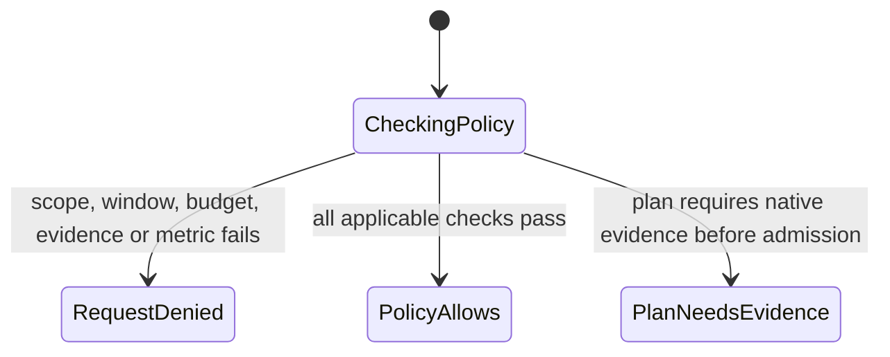

# @hobo/core

Shared kernel for HoBo production packages: the event envelope (`EventEnvelope`, with
CloudEvents conversion via `toCloudEvent`/`fromCloudEvent`), capability grants and
enforcement (`parseCapabilityGrant`, `evaluateCapabilityGrants`, `inferCapabilityUsage`),
the capability-manifest bundle parser, a minimal port container (`createContainer`), and
the typed **port contracts** other packages implement: `EventStore`, `Queue`, `Streamer`,
`VirtualClock`, `ComponentHostPort`, `WrpcLinkPort`, `BindingResolverPort`,
`TrainingEnginePort`, and `EphemeralStatePort` (short-lived TTL/CAS state with
lock and capped-ring helpers; bindings in `@hobo/kv-redis-compatible` and
`@hobo/provider-upstash`).
`TrafficRoutingPort` adds provider-neutral, tenant-scoped multi-backend routing
intent with explicit `full | partial | none` realization and capability notes.

`readThroughCache` reads a string from an `EphemeralStatePort`, loads a missing
value from the supplied source, and caches a present result for the requested
TTL. Missing values are not cached. Cache and source errors propagate to the
caller; the source remains authoritative after expiration or eviction. Cached
values can be stale until they expire or are deleted, and deletion does not
cancel a source read already in progress.

## Residency evaluation

`evaluateResidency` checks the requested region against the configured jurisdiction
catalog and transfer rules. It rejects unmapped regions, denies every region when
`global` is denied, and refuses an unrestricted footprint when any jurisdiction
is excluded. Azure's published default regions are mapped; provider placement
hints alone do not establish where data is stored or processed. Enforcement
requires the deployment path to call the evaluator with reliable provider evidence.

## Honest scope

Implemented: parsers, derived record constructors, error taxonomies, the port
type contracts, the deterministic-clock/queue/streamer value helpers, and the
public-API surface guard (`assertCoreApiSnapshot` against `CORE_API_SNAPSHOT`).
Deliberately not here: no port has a production backend in this package — the
`EventStore`, `Queue`, `Streamer`, and host ports are interfaces plus parse
helpers; implementations live in runtime/provider packages. No I/O, no network,
no persistence.

`createTrustedVault` keeps its own copies in buffers, refuses reads after expiry,
and clears them when the event loop handles the expiry, on explicit removal,
or at normal process exit. It does not serialize their values.
Its string inputs and revealed values may have other copies that JavaScript
cannot reliably erase; it does not guarantee complete memory zeroization.

### HONEST SCOPE — deployment phases and schema diff

`ports/phase.ts` (ADR-0158) ships **vocabulary, parse boundaries, and the
`assertCapabilityPhase` enforcement primitive only**. There is no handler
pipeline and no `ctx.bindings` here: nothing in this package intercepts a
capability access, so enforcement happens where a host calls
`assertCapabilityPhase` — a host that never calls it is never protected.

The schema-diff plan digest binds the normalized current and desired schemas as
well as the ordered steps and engine identity. The canonical engine version is
`6.0.0`: its digests differ from earlier versions, so existing plans must be
regenerated before comparison or execution. Replacing an index with the same
name drops and recreates it in the contract phase; HoBo's PostgreSQL schema port
applies each phase in one transaction. A replaced primary key is removed before
its replacement is added.

`ports/schema-diff.ts` (ADR-0160) owns the canonical schema IR and the
forward-only expand/backfill/contract differ. What it deliberately does **not**
do: it emits **no SQL** (`CANONICAL_SCHEMA_DIFF_ENGINE` has no `emitSql`; SQL
emission belongs to toolchain adapters such as `@hobo/adapter-drizzle`, which
fail closed when the toolchain is missing); it models **postgres only** and
refuses any other `dialect` rather than pretending to model it; it models
tables, columns and indexes, so foreign keys, check constraints, enums,
sequences, partitions, views, triggers, and column ordinal position are **not**
represented and a schema that relies on them is under-described rather than
mis-described; the type-widening lattice is a small documented set
(`smallint→integer→bigint→numeric`, `real→double precision`,
`char→varchar→text`, plus parameter growth like `varchar(32)→varchar(64)`) and
every conversion outside it is classified as a **narrowing** — conservative on
purpose, because calling an unknown conversion safe is how an expand phase
loses data. The differ does not model index renames, so distinct names are
treated as a drop and an add.

## Data-store vocabulary, catalog records and self-hosting

`ports/data-store-offerings.ts` is the portable data-store vocabulary bound to
the generic offering resolver. Provider ids identify either a service that
offers multiple engines (`aws-rds`, `gcp-cloudsql`) or a specific product
(`aws-rds-postgres`, `aws-aurora-postgres`, `azure-postgres-flexible`,
`neon-postgres`, …).
Offering ids cover topology (`replica.multi-region`, `write.multi-writer`,
`ha.failover`), logical replication by direction
(`replicate.logical-publish`, `replicate.logical-subscribe`) and connection
facts (`pool.transaction`, `auth.password`, `auth.identity-token`,
`tls.public-ca`).

For offering requests, `require` accepts only stable, real native capabilities.
`prefer` may select a fallback or a preview, experimental, simulated, mocked,
or Camp-only offering; the result is partial and names any degraded offerings.
When no single provider meets a strict request, remediation lists the providers
that actually supply each requested capability.

`ports/data-store-catalog.ts` adds evidence: `parseDataStoreCatalogEntry`
refuses an asserted claim that names no dated vendor source, `unknown` is the
only unsourced realization, and `dataStoreProfileOf` derives the resolver
profile from the claims. `ports/self-hosted-data-store.ts` is the pure
`assessSelfHostedDataStore`, which reads a provider's declared compute feature
tokens and Yard profiles and returns `can` / `cannot` / `undetermined` with
reasons. A provider package can add cited, per-product **host forms**
(`parseRegisteredHostForm`) about products it already declares; the assessment
then lists every form, so one provider can show a form that qualifies beside
one that does not. Core holds no vendor facts; the PostgreSQL catalog built from these
is in [`@hobo/cloud-providers`](../cloud-providers/README.md).

## Durable lifecycle gate leases

`ports/durable-lifecycle-gate.ts` (`createDurableLifecycleGate`) runs every
transition under an `AsyncActorLease` on its `hosting-lifecycle-gate:` stream.
The gate supplies that lease's fence token when it writes a checkpoint
snapshot. A store used for protected streams must enforce the live token at
commit; accepting the option alone is not evidence of enforcement.
Two lease rules keep a participant from leaking:

- **A failed release never undoes a commit.** After the locked work (for
  example the `ParticipantStarted` append in `begin()`) has committed, an error
  from `lease.release()` is swallowed: the lease expires on its own, and
  `begin()` still returns the participant handle, so `finish()` can remove it
  and `seal()` can complete. If the work itself fails, that error is the one
  thrown.
- **Finish and retire wait out contention.** Supervisor transitions
  (`initialize`, `drain`, `seal`, `resumeDrain`, `stop`, `open`) give up on a
  busy lease after about 800ms. `finish()` and `retireParticipant()` back off
  exponentially (10ms doubling to 500ms) for about 60s, which covers a `stop()`
  holding the lease through a slow `verifyDrained`. Every call still throws
  once its budget runs out, and callers retry: `finish()` on a removed
  participant is a no-op, and a retried `retireParticipant()` that throws
  should be followed by a `status()` read to see whether the participant has
  already gone.

## Commands

```bash
pnpm --filter @hobo/core run build
pnpm --filter @hobo/core run typecheck
pnpm --filter @hobo/core run lint
pnpm --filter @hobo/core run test
pnpm --filter @hobo/core run test:contract:consumer
pnpm --filter @hobo/core run test:contract:provider
```

## Parse, don't validate

Untrusted input crosses named parser boundaries and becomes frozen derived types:
`parseEventEnvelope` → `EventEnvelope`, `parseCapabilityGrant` → `CapabilityGrant`,
`parseCapabilityManifestBundle` → `CapabilityManifestBundle`, plus branded ids like
`ResourceId`, `QueueName`, `TrajectoryId`, and `WireVersion` from their `parse*`
functions. Failures throw typed errors (`EnvelopeParseError`, `CapabilityParseError`,
`QueueParseError`, …) — parse, don't validate. Wire forms live in `data-models/*.proto`
with CUE constraints alongside.

The deployment-phase and schema-diff ports follow the same boundary:
`parseDeploymentPhase` / `parsePhaseScope` / `parsePhaseScopeFromEnv` →
`DeploymentPhase` and `PhaseScope` (an unknown `HOBO_PHASE` or `HOBO_DEV` value
is refused, never defaulted), and `parseSchemaIr` → a deeply frozen,
name-sorted `SchemaIr` whose derived types `diffSchemaIr` turns into a
`MigrationPlan` — a pure, deterministic, forward-only expand/backfill/contract
plan whose `digest` covers the engine id and version, so an engine upgrade is a
visible plan change. Refusals carry `SchemaIrParseError` /
`PhaseParseError` codes; a phase-scoped capability touched outside its phase
raises `PhaseViolationError` with `code: "PHASE_VIOLATION"`.

Traffic routing follows the same boundary: `parseRoutingPlan` produces a deeply
frozen `RoutingPlan` with branded plan/backend/Station identifiers, while
`TrafficRoutingParseError` rejects malformed plans before adapters see them.
`parseTrafficRoutingPlanRecord` and `toTrafficRoutingPlanRecord` reconcile the
generated protobuf record/JSON enums with that frozen domain view; protobuf's
absent scalar/list defaults normalize optional `degraded`/`notes` to `false`/`[]`.

## Position in the event architecture

`@hobo/core` defines the vocabulary of the event architecture — envelopes, principal
refs, and the `EventStore`/`Queue`/`Streamer` port contracts — but hosts no actor,
appends nothing to any event store, and maintains no projection or read store itself.
Commands, events, actors, and materialized views are owned by the packages that
implement or consume these ports; this package only guarantees their records parse.

The bounded WHATWG HTTP adapter treats `TransportResponse.body` as UTF-8 text.
It rejects malformed or truncated UTF-8, preserves an observed leading BOM, and
cancels a failed response before releasing its reader. This prevents text
normalization from making different served bytes appear to match an approved
artifact digest. Binary protocols need an explicit bytes/base64 boundary;
replacement characters are not a valid binary transport.

## Shared budget policy verification

The shared policy evaluator checks scope, funded windows, measured constraints,
and projected integer costs for CI and hosting. Strict admission requires a
native-bound label supplied by the caller; the caller must authenticate that
evidence. Omitted constraints mean none; an explicit non-array constraints
value, including `null`, is refused. The
[verification skill](../../.agents/skills/verify-shared-budget-policy/SKILL.md)
records generated implementation tests, the bounded state model, the
unbounded arithmetic obligations, and their assumptions.

Malformed evaluation contexts and measurement collections or records return a
refusal. Measurement keys, units and optional targets must satisfy the same
shape rules as policy constraints. This validates the supplied evidence's
shape; the caller remains responsible for authenticating its source.
Scope identifiers and metric targets reject unpaired Unicode surrogates so
protobuf encoding cannot silently change them. Target length is measured in
Unicode code points, matching the authored CUE contract.

The model's user-facing projection collapses internal checks into the following
flow. It hides 128 same-label transitions from 256 explored steps.


