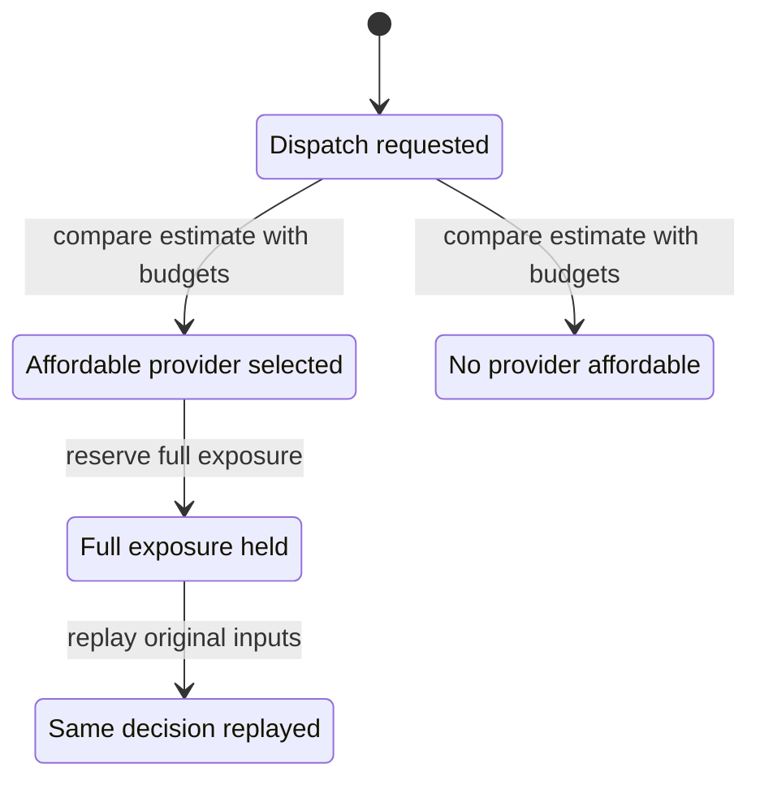
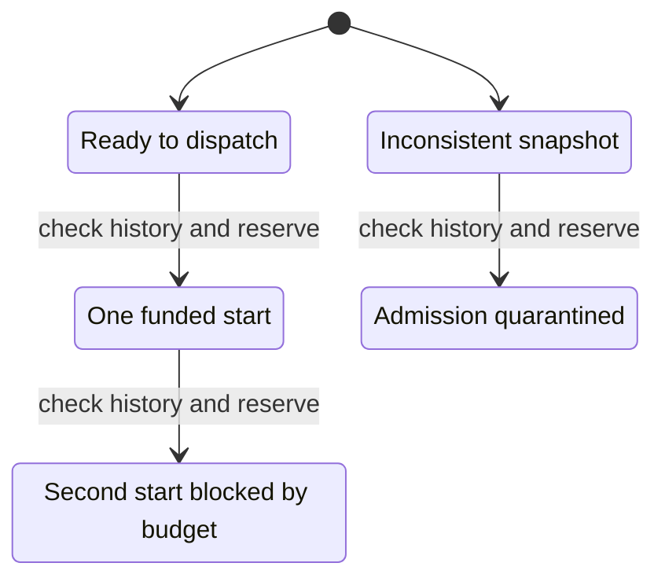
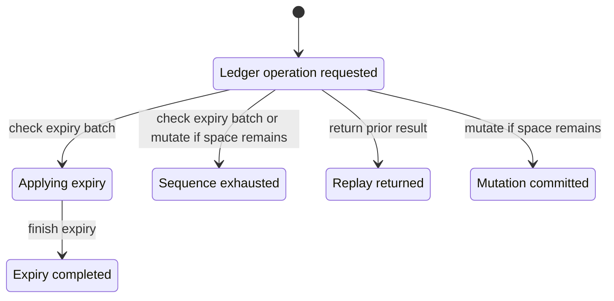
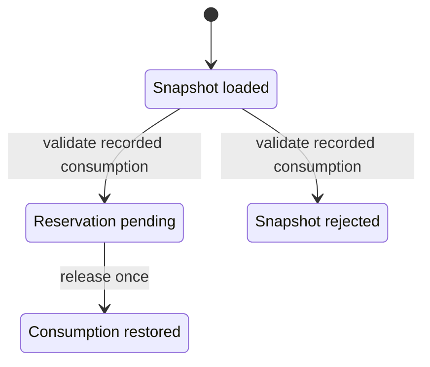

# @hobo/dispatcher

The Dispatcher (ADR-0071): deterministic, credit/budget-aware selection across
registered providers for placement (`match.Decided`), dispatch
(`dispatch.Decided`), and traffic (`traffic-backend` category — consumed by the
stations routing control loop).

- Ranks candidates by effective marginal cost against a pinned
  `CreditLedgerView@seq` (free tiers, rate/concurrency headroom, budget caps,
  switching cost, soonest-expiring credits).
- Hard budgets and declared rate/concurrency limits remove candidates from
  eligibility. When every candidate is ineligible, no decision fact is emitted.
  Invalid facts cannot erase an explicit hard budget.
- Hysteresis requires both a savings margin and challenger-bound continuous
  evidence (`challengerProviderId`, `savingsSince`, `observedAt`) covering the
  ISO duration `dwellWindow`. Missing evidence holds an eligible incumbent;
  an ineligible incumbent cannot be held.
- Reservation ledger with CAS (`expectedSeq`) so concurrent dispatches cannot
  double-spend free headroom; reserve/confirm/release/expire emit
  `dispatch.Reservation*` facts.
- `replayDispatchDecision` replays identical inputs to a byte-identical
  decision fact.
- **`decideDispatchV2`** (schema `hobo.dispatcher/v2`) ranks registered providers
  by minimum incremental **billed** amount from `@hobo/pricing` quotes; v1
  `decideDispatch` continues to use credit ranking.

## Dispatcher v2

`decideDispatchV2` and `@hobo/dispatcher/v2` use schema
`hobo.dispatcher/v2`. For each candidate's `QuoteScenario`, the adapter calls
`@hobo/pricing` and ranks exact `incremental.billed` decimals under the
`min-incremental-billed` objective. Provider ID breaks equal-cost ties.
Rejected, stale, partial, unpriced, or cross-currency quotes fail closed and
never fall back to list price. `DispatchCostQuote` omits the advisory
`allocatedEffective` field. A fixed-fixture SHA-256 golden pins an existing v1 decision; the numeric safety corrections below can change v1 decisions for edge cases.

`CreditAccount.reservedCost` holds pending monetary exposure in the account's
declared currency, using the existing `budgetCap`/`listUnitCost` number units.
`reserve({ expectedSeq, reservationId, providerId, dimension, units, unitCost?,
switchingCost?, estimatedCost?, expiresAt? })` checks budget and capacity in the
same CAS operation. `estimatedCost` may raise the reservation to a quoted
all-in total; it cannot lower the modelled exposure. A caller must supply the
appropriate account and authoritative quote, including the unit price when it differs from the account list price: missing accounts retain the
legacy unconstrained selection behavior and do not establish a budget guarantee.
The combined selection-and-reservation helper uses the account price for both
steps when present, falling back to the registry price. It selects the provider
registration for the requested category, including that registration's dimension.
When an all-in `estimatedCost` is supplied, selection excludes each provider
whose budget cannot cover that estimate as well as its calculated cost. New
decision replay inputs retain the estimate; older inputs without it keep their
original selection behavior.

New dispatcher tie-breaks use ECMAScript string code-unit order rather than the
host locale, including equal-expiry credit consumption and v2 provider order.
When a v1 decision compares distinct strings, its replay input records the
ordering version. Unversioned historical inputs use the former local collation
for compatibility and need the original locale to reproduce a tied result. A
legacy reservation that replays to a different provider is quarantined by the
history check and needs reconciliation. The v2 pricing engine can still contain
locale-sensitive ordering inside its quote calculation; this change only fixes
the dispatcher ordering around the returned quotes.

An older helper could reserve a different category when a provider had multiple
registrations, leaving the intended account without its hold or settlement. The
helper now checks recorded replay inputs for pending, running, and confirmed
reservations and returns `ledger-reconciliation-required` when it detects an
inconsistent category, cost, or binding. It replays those records on each call,
so the check adds work proportional to retained history. Before admitting work
after upgrade, reconcile affected holds and provider usage against trusted
records; the helper cannot reconstruct missing history or authenticate a
plausible snapshot. Direct ledger calls and records without replay inputs do not
receive this check, so quarantine them at the admission authority until reviewed.

Pending reservations debit free allowance and rate headroom, occupy one
concurrency slot, and hold paid exposure. `release` restores those quantities
once for never-started work. `start({ reservationId, committedSeq? })` marks the
hold running; its fact must commit durably **before** an external call or
outbox dispatch. A supervisor may expire a pending hold only after establishing
the execution outbox was not dispatched or has been fenced. A running hold
survives actor leases, timeout sweeps and cancellation requests; those requests
do not prove provider work stopped or billing finalized.

`confirm({ reservationId, actualCost?, providerUsageSeq?, usageFinalized?, usageEvidenceRef? })` settles cost
(defaulting to the estimate), releases concurrency and monetary holds, and keeps
used allowance/rate consumed. Actual overruns are recorded truthfully and
returned as `budgetExceeded`; confirmation never invents a refund to stay under
a cap. Importers must reconcile `providerUsageSeq` rather than charging the same
settlement again. This package is an in-memory aggregate; callers own durable
single-writer fencing, quote authority, execution start/termination and usage
reconciliation. Running work requires explicit `actualCost`,
`usageFinalized: true`, and an auditable `usageEvidenceRef`; unresolved billing retains the entire hold. Positive
provider cancellation/absence and final usage evidence are the caller's
authority to settle a running operation, including an actual cost of zero.

Reservation IDs are unique. Identical pending reserve retries return the
original commitment without another debit; changed payloads fail. Terminal or
expired IDs cannot authorize new work. The dispatch-and-reserve helper persists
its replay input in the reservation, so a retry retains the original winner.
Imported reservations are checked before use: free and rate consumption cannot
exceed the reservation's units, a reservation can hold at most one concurrency
slot, and credit entries must be unique and fit the reserved units under the
ledger's conservative rounding. These checks reject impossible restoration
amounts; callers must still trust or reconstruct the history proving that the
recorded quantities were actually deducted.

Ledger sequence values must be nonnegative safe integers. A mutation that would
exceed `Number.MAX_SAFE_INTEGER` throws before changing the ledger; expiry
checks space for its time advance and every release before changing either.
Existing idempotent replays and no-op expiry remain available. Exhaustion also
stops settlement, so operators must migrate and reconcile the ledger to a wider
sequence format before continuing; resetting the counter would invalidate its
fencing guarantee.

`freeHeadroom`, when present, is the aggregate cap; `credits` are its grant
breakdown, not additional copies of the allowance. Without an aggregate the
grant balances are summed. Expiring grants require pinned `ledger.asOf` and
are consumed earliest-expiry first. `expire({ now })` advances that pinned time
monotonically through `dispatch.LedgerTimeAdvanced` before expiring holds;
release never makes an expired grant eligible again. Expiry only releases a
reservation: execution owners must stop or fence work before returning its
remaining financial exposure to the pool.

See [`ARCHITECTURE.md`](./ARCHITECTURE.md) for evidence and
[`contracts/`](./contracts) for the v1 and v2 PACT boundaries.

## Budget verification

The [budget-policy routing skill](../../.agents/skills/verify-budget-policy-routing/SKILL.md) describes generated reservation histories, the bounded TLA+ model, and an exact-arithmetic proof of an abstract budget invariant. The legacy number contract is interpreted as decimal values; liabilities round upward and available balances downward when conversion back to numbers requires it. This protects the budget conservatively but can leave tiny residual holds or reject an edge-case request that is exactly affordable in decimal arithmetic. Provider overruns are recorded, and callers remain responsible for authoritative quotes and fencing.

Run `bash scripts/verify-state-machine.sh .agents/skills/verify-budget-policy-routing` from the repository root. The abstract proof does not establish that the TypeScript implementation refines it.

The estimate-routing model checks 98 bounded states, with two providers and a
shared estimate. Its projection hides 27 same-state transitions.

The category-scope model checks 54 bounded states and hides 27 same-state
transitions. It assumes a mismatched imported record has already been detected.

The sequence model explores 88 states with a maximum revision of three and up
to two pending reservations. Its projection hides 46 same-state transitions.

The consumption model checks an abstract free, rate, credit, or slot quantity
in 129 states. Its projection hides 48 same-state transitions.

