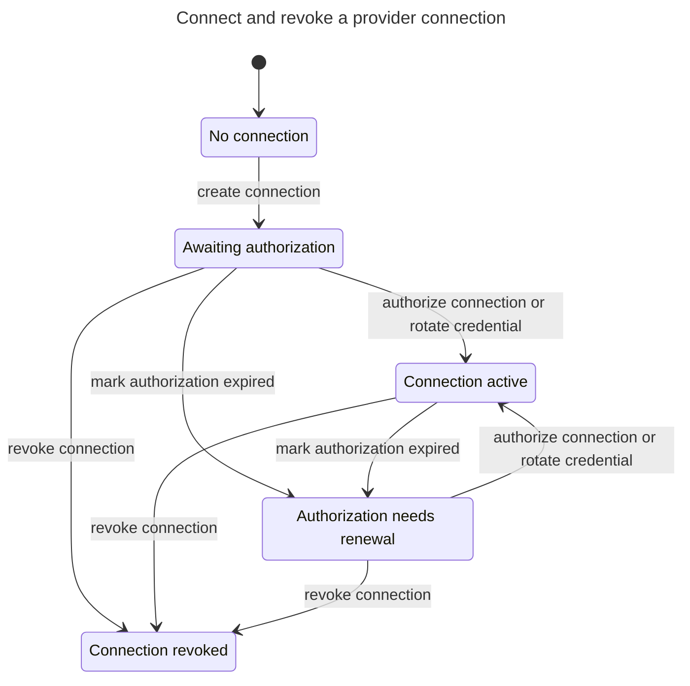

# @hobo/identity

Production identity service for HoBo: SPIFFE JWT-SVID issuance from workload
attestation, OIDC discovery/JWKS verification, scope-narrowing rotation, an
append-only credential-audit event stream, and a per-deploy token broker. S2-04
promotes the near-production draft proof
(`src/draft/projects/s3-02-hobo-identity/`) into `packages/identity/`.

## What it does

- `IdentityService` — mints a JWT-SVID for an attested workload
  (`issueSvidFromAttestation`), rotates within the renewal grace window
  (`rotateSvid` / `rotateSvidWithScope`, which rejects scope widening),
  authenticates a token at the gateway (`authenticateAtGateway`), and exposes
  OIDC `discovery()` / `jwks()`. TTL defaults to 900s, renewal grace 300s.
- `TokenBroker` — holds one vaulted root credential and mints per-deploy,
  scope-bound, TTL'd tokens for an SVID, emitting `token.Granted` / `token.Used`
  / `token.Revoked`.
- **Residual secrets backends** ([ADR-0027](../../docs/design/adr/02-identity-security.md#adr-0027) /
  [ADR-0113](../../docs/design/adr/02-identity-security.md#adr-0113)) — secretless-first
  ladder is bound-resource → provider-federation → camp-value → static-escape.
  Built-in residual adapters in `@hobo/identity` (never primary identity):
  - **`createMemorySecretsPort`** — default in-memory residual (local Station / fixtures)
  - `createVaultJwtSecretsPort` — Vault via short-lived SVID JWT (no static Vault token)
  - `createAwsSecretsManagerPort` / `createAzureKeyVaultPort` — brokered live + offline
  - `createCampSecretsPort({ backend: "memory" | "vault-jwt" | "aws-sm" | "azure-kv" })`
  - **`createLocalStationSecretsPort`** — local Station residual; **defaults to memory**
    (`HOBO_LOCAL_SECRETS_BACKEND=memory|vault-jwt`). Wasm guests never see material.
  - `asHoboSecretsStore` — WIT-shaped residual view over any port
  - **Optional OpenBao:** install **`@hobo/adapter-openbao`** (not a default dependency)
    for residual OpenBao JWT + KV v2. Not included in default installs.
  - **Optional Infisical:** **`@hobo/adapter-infisical`** implements the
    `infisical` port kind (workload OIDC sign-in, no secret zero); the hosted CI
    relay's config service (ADR-0179). Not a default dependency.
- Every identity and token event carries the never-compact
  `CREDENTIAL_AUDIT_RETENTION` descriptor.
- **Continuous Identity Migration Plane** ([ADR-0132](../../docs/design/adr/02-identity-security.md#adr-0132))
  — dual-path PrincipalRef continuity when adapters, residency, spectrum, or
  Yard placement change. **Nothing is required in the Bindle** for continuous
  migration: Matching + policy activate dual mode; progressive ramp uses
  existing Harness cohort flags; dual fixtures extend [ADR-0070](../../docs/design/adr/02-identity-security.md#adr-0070)
  for offline `hobo dev` / tests. Observe with `hobo identity status` /
  `hobo identity inspect <id>` and `hobo doctor`. Composed into **HoBo Trails**
  ([ADR-0134](../../docs/design/adr/02-identity-security.md#adr-0134),
  `@hobo/trails`) as the platform recipe `identity.continuous` — pure identity
  continuous cases still require **zero Trail authoring**.
- **The Harness** ([ADR-0083](../../docs/design/adr/02-identity-security.md#adr-0083) /
  [ADR-0044](../../docs/design/adr/02-identity-security.md#adr-0044)) — progressive
  delivery as a native plane: single `FeatureFlagStore` (shared with identity
  migration cohorts — **no parallel store**), OpenFeature-only app API
  (`HoboOpenFeatureProvider` / `HoboFeatureClient`), OpenDelivery staged
  rollouts + auto-rollback obligations, OpenExperiment assignment/exposure,
  policy-gated mutations, and contract-asserted local fixtures. Bindle IfC:
  `features()` / `declareExperiment()` / `rollout()` from `@hobo/bindles`.
  CLI: `hobo feature list|eval|set|kill|canary|experiment`.

## The Harness (feature flags · progressive delivery · experiments)

```ts
import {
  FeatureFlagStore,
  createLocalFeatureClient,
  createHarness,
  createContractAssertedHarnessFixtures,
  enrichEvaluationContext,
  gateFlagMutation,
} from "@hobo/identity";
import { features, rollout, declareExperiment } from "@hobo/bindles";

// Bindle IfC (schema is truth; runtime values live in the store)
const appFeatures = features({
  "new-checkout-flow": {
    state: "ENABLED",
    percentage: 10,
    variants: { control: false, treatment: true },
    defaultVariant: "control",
  },
});

// Sole public evaluation API shape (OpenFeature)
const store = new FeatureFlagStore();
const client = createLocalFeatureClient(store, { userId: "user:alice", tenant: "acme" });
const on = client.getBooleanValue("new-checkout-flow", false);

// Progressive composition: flag ramp → gateway weight → auto-rollback
const harness = createHarness({ store });
const run = harness.startProgressive({
  rollout: {
    name: "checkout-canary",
    flag: "new-checkout-flow",
    stages: [{ percent: 5 }, { percent: 25 }, { percent: 100 }],
    traffic: "gateway-weighted",
    autoRollback: true,
  },
  experiment: {
    name: "checkout-exp",
    flag: "new-checkout-flow",
    variants: ["control", "treatment"],
  },
});
// Offline local path
const fx = createContractAssertedHarnessFixtures();
fx.client.getBooleanDetails("example-feature", false);
```

Application code **never** imports flagd, Unleash, GrowthBook, LaunchDarkly, or
Argo. External backends rank behind `hobo:feature-flag` / `hobo:delivery` /
`hobo:experiment` ports (local-builtin → camp-managed → ofrep-internal → external).
`FeatureFlagPort` describes the local store boundary used by the OpenFeature
client, progressive engines, and HoBo's feature command. `FeatureFlagStore`
implements it; tests can inject another implementation or use an isolated
`flag` resource from `@hobo/testing`. This TypeScript port does not claim to
implement the complete WIT provider contract.
`DeliveryPort` and `ExperimentPort` describe the rollout and experiment
boundaries. `createHarness` accepts implementations as `delivery` and
`experiment`; when omitted, it creates the built-in engines. Injected engines
that coordinate with feature evaluation should use the same `FeatureFlagPort`
passed as `store` so their flag changes are visible to the harness.
Gateway-weighted rollouts emit `domain.RoutingChanged` via
`applyRolloutToGatewayRouting`. Experiment `analyzeExperiment` /
`concludeExperiment` use the built-in baseline analysis/export. The baseline
counts assignments and exposures but returns `inconclusive`: allocation counts
are not outcome evidence. Supply an `analysis` adapter to make an evidence-based
release decision.

`assign` and `getAssignment` report the subject's sticky allocation, while
`expose` and `evaluateAndExpose` evaluate the current flag and record that
evaluation's variant. When it differs from the assignment, the latter returns
the evaluated variant with `assignedVariant` and `reason`; exposure
events always include both variants and the evaluation reason. A targeting rule,
kill switch, disabled flag, or rollout gate can cause that difference. Custom analysis ports
receive exposure records as an optional fourth argument; subject identifiers in
those records are hashed. Assignment counts alone do not measure outcomes.
The existing flag `rulesetSeq` is local to a store instance and must not be used
to identify a ruleset across reloads or replicas.
When the application uses a non-default flag fallback, pass the same fallback
to `expose`, `evaluateAndExpose`, or `trackExposure`.
For post-hoc tracking, pass the exact evaluation that was served to
`exposeEvaluated`; it checks the flag and a canonical context binding, so a
later flag change does not rewrite the recorded experience. For a single
evaluate-and-record operation, `evaluateAndExposeDetails` returns the evaluation
whose value the application should serve. Context bindings prevent accidental
mix-ups; applications must still trust the source of supplied evaluations.

The built-in flag store uses a separately salted deterministic allocation for
a new experiment after the rollout gate. Explicit targeting rules take precedence.
An existing fractional split on the experiment's flag retains its exact subject
assignments at 100%; its rollout gate uses a separate hash. Attaching to an
existing fractional flag with a percentage below 100 is refused before any
mutation because fractional flags previously ignored that percentage. Set it to
100 before attaching, then change the experiment's ramp explicitly. Unrelated
fractional flags retain their existing behavior.
An attached allocation, its sticky key, and its fractional key and weights are
immutable; use a new experiment and flag to change them. Assignment is deterministic across restarts only while its
definition and subject key remain unchanged. This allocation algorithm changes
new experiment assignments from the previous process-local implementation.
Assignments are recorded per tenant and targeting key. When a different sticky
attribute drives allocation, multiple targeting keys can receive the same
variant and create separate assignment records. `getAssignment` accepts an
optional tenant and returns no assignment when an omitted tenant would be
ambiguous.
An injected flag port must advertise `experimentAllocationVersion: 1` and expose
the atomic `applyExperimentAllocation` operation. The engine checks the declared
capability and returned configuration, but cannot prove an adapter's evaluation
behavior from those claims. Run `runExperimentFlagPortConformance` with an isolated
fixture before using a replacement; this bounded check does not prove every
provider behavior. The allocation helpers are exported for implementing the
contract. If an apply throws or returns an unexpected result,
the engine reports `experiment-allocation-reconcile-required`: inspect the flag's
state before retrying because an external adapter may have partially changed it.
`startProgressive` validates the matching flag, experiment, and rollout policy
before creating state. An injected experiment port can also implement the
read-only `validateDefinition` operation for its own preflight checks. If a
later start operation fails after mutation may have begun, the harness reports
`progressive-start-reconcile-required` or
`experiment-allocation-reconcile-required`; inspect the flag, experiment, and
rollout before retrying.

A kill switch keeps its effective percentage at zero. Its `suspendedPercentage`
records the intended ramp in the definition and change event, including explicit
changes made while the switch is active. Clearing restores that value; a legacy
killed definition without a saved value stays at zero until changed explicitly.
When replacing a killed definition, set `suspendedPercentage` to the intended
resume value.

## Continuous identity migration (hands-off)

```ts
import {
  decideIdentityMigration,
  defaultContinuousMappingSpec,
  createContractAssertedDualFixtures,
  IdentityMigrationService,
  evaluateCanMigrate,
} from "@hobo/identity";

// Matching decides — no Bindle dual-adapter block required.
const decision = decideIdentityMigration({
  tenant: "acme",
  sourceAdapter: "oidc-legacy",
  targetAdapter: "oidc-modern",
});

const dual = createContractAssertedDualFixtures({ tenant: "acme" });
const can = evaluateCanMigrate({
  sourceAdapter: dual.sourceAdapter,
  targetAdapter: dual.targetAdapter,
  mapping: dual.mapping,
  dualOracleReady: true,
});

const svc = new IdentityMigrationService({ tenant: "acme" });
svc.start({
  tenant: "acme",
  sourceAdapter: decision.sourceAdapter,
  targetAdapter: decision.targetAdapter,
  mapping: decision.mapping,
  reason: decision.reason,
  mode: decision.mode,
  matchDecisionId: decision.decisionId,
});
// JIT link keeps both adapters valid until cutover (ADR-0100 grace patterns).
```

## Deferred: keyless provider-STS exchange (S3-03)

The broker returns a deterministic fixture-scoped token derived inside the
vault. The real keyless OIDC-federation / provider-STS token exchange is a later
item (S3-03); see the `ponytail:` note in `src/token-broker.ts`.

## HoBo Fleet additions

- **`loadSecretStoreKms(secrets, { prefix })`** — the fleet authority's
  token-signing key, shared by every replica and kept across restarts. One
  secret named `prefix` holds a JSON key ring
  (`{"keys":[{"kid","privateKey" (PKCS#8 PEM),"retiredAt"?}]}`). At start it is
  read once (or created once, with kid `<prefix>#1`; replicas that start
  together adopt the first version written) and held in memory behind the
  synchronous `KmsLike`. Rotate with `JwtSvidIssuer.rotateSigningKey("<prefix>#<n+1>")`:
  the previous key stops signing at once, stays in the key set for 15 minutes
  (the longest token lifetime) so its tokens still verify, and
  then leaves `jwks()` everywhere. The rotation is written back to the store in
  the background, merged with what is there; another replica sees it when it
  next loads. The active key is the highest `n` for which `hasKey` is true. A
  store refusal other than `secret-not-found`, or a value without material,
  fails closed. `createInMemoryKms` remains for tests and offline development.
- **`createDeviceHostAttestor(signer)`** — a fleet device as attestation host.
  It takes the device's SIGN key (`<member id>#sign`), uses the member id as
  `hostId`, and signs the launch measurement's JSON bytes as a fleet envelope
  under `hobo-fleet/host-attestation/v1`. `hostSignature.algorithm` is
  `hobo-fleet-envelope/eddsa` or `…/es256` (`envelopeAlgorithmOf` and
  `envelopeAlgorithmName` map the names); `value` is
  `base64url(payload).base64url(signature)`. `publicKeys()` is empty: the
  verifier passes the SIGN key from the member's key bundle as
  `verificationKey`. `verifyWorkloadAttestation` checks the signature over the
  received bytes, then that they are the document's launch measurement.
  `createFixtureHostAttestor` (HMAC) stays for tests.

## Exports

- `IdentityService`, `createFixtureHostAttestor`, `verifyWorkloadAttestation`,
  `JwtSvidIssuer`, `createInMemoryKms`, `verifyJwtWithJwks`.
- `TokenBroker`, `createInMemoryVault`, `TokenScope`, `ScopedTokenGrant`.
- Event factories/validators and `CREDENTIAL_AUDIT_RETENTION`.
- `IDENTITY_PORT` — the `IdentityProvider` port descriptor built through
  `@hobo/core`.
- Migration plane: `IdentityMigrationControlPlane` (Matching → auto-start →
  OpenFeature ramp → cutover), `IdentityMigrationService`,
  `decideIdentityMigration`, `evaluateCanMigrate`,
  `createContractAssertedDualFixtures` / `createDualAdapterPair`,
  `FeatureFlagStore`, `runSpectrumIdentityCutover` (Plan 50 composition),
  `dualVerifyClaims`, `mintDualAudienceGrant`, `advanceMigrationRamp`,
  `agentActionsForMigrationEvents`, `identity.Migration*` events.
- Harness: `FeatureFlagPort`, `DeliveryPort`, `ExperimentPort`, `HoboOpenFeatureProvider`, `HoboFeatureClient`, `createHarness`,
  `OpenDeliveryEngine`, `OpenExperimentEngine`, `gateFlagMutation`,
  `createContractAssertedHarnessFixtures`, `enrichEvaluationContext`,
  `selectFeatureFlagBackend`, `flag.*` / `rollout.*` / `experiment.*` events.

## Connection revocation

Provider connection revocation is terminal. Authorizing or marking a revoked connection for reauthorization is rejected; create a new connection instead. Replay also ignores late authorization, health, rotation, and duplicate creation facts that would revive the revoked connection.

Connection IDs and aliases share the lookup namespace. Creation and replay
reject a new connection when its alias conflicts with an existing ID or alias,
or its ID conflicts with an existing alias. Existing event logs with those
collisions require reconciliation before they can be replayed.

The `verify-connection-lifecycle` skill checks those rules with generated
command and replay histories, bounded TLA+ models, and scratch mutations. This chart summarizes
the model; it is not a live provider trace:



TLC explores one connection and one subject; six same-label steps are hidden.
The model does not prove provider revocation or credential-vault behavior.

## AuthOnboarding Alchemy Domain & Portable Host (`@hobo/identity/domain`, `@hobo/identity/host`)

`@hobo/identity/domain` models HoBo auth onboarding, owner-vault signing-key verification (`OwnerVaultPort`), Better Auth issuer bootstrap (`BetterAuthIssuerPort`), and reusable cross-restart / cross-box sessions as an `@alchemy.run/domain` `Model` (`AuthOnboarding`) and authenticated `Api` (`AuthOnboardingApi`):

- Aggregates: `AuthWorkspace` (`Uninitialized` → `VaultConfigured` → `ProvisioningIssuer` → `Ready` | `Suspended`) and `AuthSession` (`Empty` → `Active` → `Revoked`, enforcing deterministic clock expiry, signing-key fingerprint matching, and workspace-authorized cross-box reuse).
- Saga & Policies: `BootstrapAuthWorkspace` verifies `owner://` signing-key locators and Better Auth migrations, failing closed with vault-cache invalidation compensation on failure; `StartBootstrapPolicy` and `SessionRevocationPolicy` react to issuer configuration, signing-key rotation, and session revocation.
- Security boundaries: `CurrentAuthActor` (`Domain.RequestContext`), `AuthSessionMiddleware` (`RpcMiddleware.Service`), `WorkspaceOnboardingView`, and `ActiveSessionView` enforce owner isolation without storing raw secrets in domain state or events.

`@hobo/identity/host` runs the exact same model on `Domain.InMemory` (`createAuthOnboardingInMemoryLayer`), `@hobo/storage-sqlite` (`createAuthOnboardingSqliteLayer`), or `@alchemy.run/domain/Rivet` (`createAuthOnboardingRivetLayer`), plus a RivetKit SQLite cross-box session coordinator actor (`createAuthSessionCoordinatorRegistry`) and HMAC-signed request-context middleware (`createSignedAuthSessionMiddlewareLayer`).

## Verification

```sh
pnpm --filter @hobo/identity build
pnpm --filter @hobo/identity typecheck
pnpm --filter @hobo/identity test
pnpm --filter @hobo/identity test:contract:consumer
```
