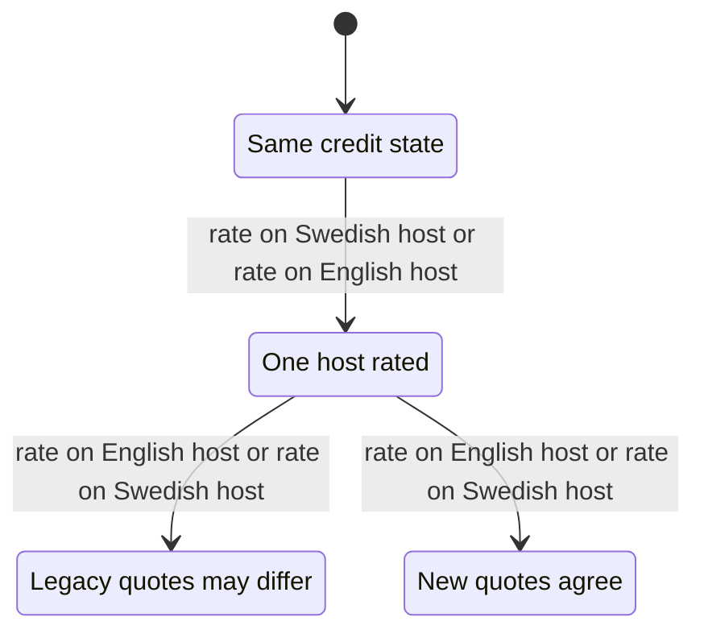
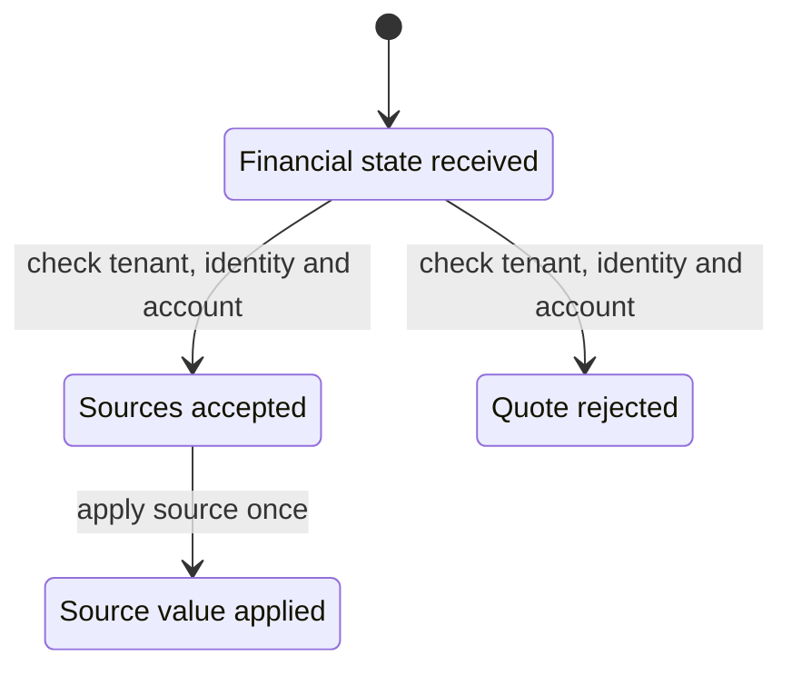
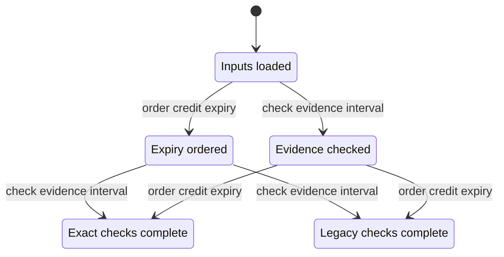

# @hobo/pricing

Pure provider-cost rating for HoBo routing and FinOps. It models provider
commercial terms only; customer billing, payments, tax, and invoices are out of
scope. The normative design is
[`docs/design/provider-pricing-commercial-terms.md`](../../docs/design/provider-pricing-commercial-terms.md)
and ADR-0176 records the package boundary.

## Batch 2 surface

`QuoteEngine.quote(scenario)` (also available as `quoteScenario(scenario)`)
accepts the generated `QuoteScenario` protobuf type and returns
`QuoteVector | PricingRejected`. It rates fixed and usage charges, allowances,
paid/promotional credits, and provider-actual spend commitments. Baseline and
candidate snapshots use the same pinned state; incremental amounts are
`F(baseline + candidate) - F(baseline)`.

New quotes use `pricing-rating/v5`. It orders ties by string code units,
compares UTC instants without truncating fractional seconds, rejects impossible
calendar dates, and requires each allowance, credit, and commitment to have a
unique nonempty identity within its kind and the financial state's tenant. This
also requires a provider account on each agreement and rejects financial sources
in any state containing agreements for more than one account: grants currently
have no field identifying their account. This conservative check includes unused
and inactive agreements. It cannot establish that the supplied identities and
tenant truly correspond to provider records. The change to the algorithm version
and quote hash can change credit, rate-card,
or latest-observation choices. To rerate an old record, pass its stored version, for example
`quoteScenario(scenario, { ratingAlgorithmVersion: "pricing-rating/v1" })`.
Version 1 used locale-sensitive ordering, so reproducing an old tied quote also
requires its original locale. Versions 1 and 2 also retain their previous
timestamp comparison and millisecond validation behavior. Versions 1–3 do not
enforce the new source identity checks. Versions 1–4 also retain earlier source
amount, basis and commitment-unit behavior. Preserve the original quote as evidence
rather than treating a new v5 quote as the old one, and reconcile affected old
expiry, evidence, observation, and financial-source decisions before use.

V5 requires nonnegative source amounts and rate-card prices and compatible units.
For allowances and credits it bounds used plus remaining by the declared amount plus rollover; for
forfeiting commitments it bounds them by the declared amount. These checks treat
used and remaining as belonging to the same grant and bucket. Derived credits
must have no additional basis, and consumed credit basis cannot exceed recorded
remaining basis. Paid-credit rollover and commitment rollover or true-up fail
closed because their carried basis or bucket semantics are not represented.
Commitment consumption is recorded in its currency. These checks do not verify
that the provider's reported capacity, prior usage, or basis is authentic.

- Exact decimal strings and scaled-integer arithmetic; no floating-point money.
- Explicit unit identities/conversions; GB and GiB are never treated as aliases.
- Complete, current evidence is required through the quote horizon.
- Exclusive charge groups, currency mismatches, stale observations, unknown
  terms, and unsupported external rating fail closed.
- Credits sort by priority, earliest expiry, then grant ID. Derived credits have
  zero additional economic basis; purchased-credit basis is allocated pro rata.
- Upfront provider-actual commitments support billing-period and single-UTC-hour
  buckets; cross-hour consumption fails closed.
- No wall clock, network, environment, locale, or live provider calls.
- New agreements and cancellation are denied unless explicitly enabled.

`@hobo/pricing/legacy` exports the moved CI allocation and sandbox translators.
Their function bodies are unchanged, and `legacy_ci.proto` mirrors the two
CI-owned protobuf records with identical type names, fields, and wire numbers.
The CI package preserves its original imports through thin re-exports.

`ExternalProviderQuote` is an evidence record, not an executable pricing model.
`external-quote.ts` always rejects attempts to turn one into a rating engine.
Dispatcher v1 is unchanged; v2 lives in `@hobo/dispatcher` as
`decideDispatchV2`. Legacy CI sandbox accounting re-exports from
`@hobo/pricing/legacy`. Broker quote authorization and cloud commercial catalog
hashes integrate without changing dispatcher v1 replay.

## Phases 2–5 surface

- **`@hobo/pricing/legacy`**: moved CI decimal accounting (`allocationQuote`,
  `divideDecimalAtMost`); `@hobo/ci` re-exports preserve import paths.
- **`decideDispatchV2`**: ranks registered providers by minimum incremental
  billed amount from `quoteScenario`; v1 `decideDispatch` is byte-identical on
  the pinned replay fixture.
- **Adversarial §13**: fixtures 10.1–10.11 (including stale observation,
  cross-currency, and zero-incremental tie cases).
- **`pricing.*` events**: pinned v1 corpus entry for `pricing.QuoteCreated` in
  `@hobo/events`.
- **Broker / cloud**: `authorizeBillingSpend` prefers quote incremental USD;
  `pricingCatalogHashFromCommercialRefs` hashes commercial product refs without
  altering resource `catalogHashOf`.
- **`@hobo/pricing/sync`**: offline provider billing sync adapter (§12 Phase 5).
  Imports FOCUS-shaped rows through a `ProviderBillingPort`, dedupes by provider
  charge id, emits dated `hobo.pricing.billing-sync.snapshot/v1` snapshots,
  variance facts, and `ReconciliationRecorded` events. Fail-closed on partial
  provider data; never imported by the pure quote kernel.

## Contracts and validation

`data-models/pricing.proto` is the canonical record source. TypeScript messages
under `src/_generated/` are generated, never hand-edited. `pricing.cue` pins
decimal syntax, UTC billing periods, exclusive groups, and derived-grant basis;
valid and invalid JSON fixtures exercise those constraints.

```bash
pnpm --filter @hobo/pricing run codegen
pnpm --filter @hobo/pricing run test:schema
pnpm --filter @hobo/pricing run test:contract:consumer
pnpm --filter @hobo/pricing run test
```

The replay corpus pins complete v1, v2, v3, and v4 quote outputs. The replay test parses
each scenario through protobuf JSON, rerates it with the recorded version, and
compares the stable JSON result, including the quote hash. The quote-boundary
PACT is a hand-authored consumer expectation; no live provider accuracy is
claimed.

## Credit-order verification

The [pricing financial-source skill](../../.agents/skills/verify-pricing-credit-order/SKILL.md)
checks source admission and the equal-priority credit flow against real code,
bounded TLA+ models, and abstract balance proofs. The credit model explores 32 states and hides eight
same-state transitions; a separate counterexample shows that legacy v1 quotes
can differ by locale.



The source-admission projection covers one abstract financial source. Its
model explores 243 states and hides 96 same-state transitions; it assumes the
source identity, tenant, and account classifications reflect the provider's
actual records.



## UTC verification

The [pricing time skill](../../.agents/skills/verify-pricing-time/SKILL.md)
checks UTC validity, evidence coverage and time ordering. Its model explores
256 states and hides 64 same-state transitions. `parseUtc` returns milliseconds;
use `compareUtcExact` when fractional ordering matters.



## Architecture boundaries

Parse, don't validate starts at `parseJson` and `parseQuoteScenario`: untrusted
JSON becomes a generated `QuoteScenario` before rating. `parseDecimal` derives
the scaled-integer `Decimal` parsed type, and rating functions accept generated
messages plus these derived domain types rather than raw DTOs.

The quote kernel remains a pure query, so it has no command handler, actor,
event-store write, materialized view projection, persisted snapshot, or read store.
`rateSnapshot` builds only an ephemeral rating snapshot and never mutates a read
model. The declared `pricing.*` events belong to later actor integrations; those
integrations must consume commands, append events to an event store, and build
materialized-view projections and snapshots in a read store outside this pure
rating path.
