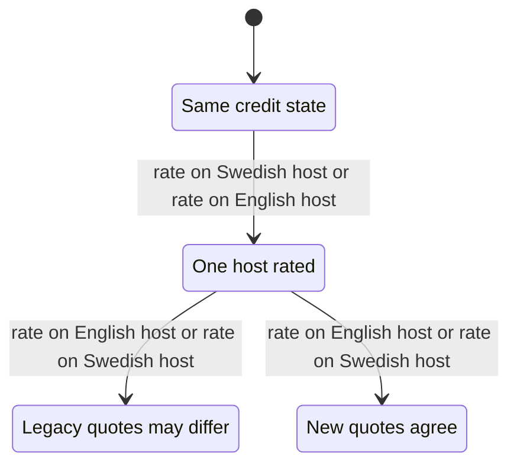
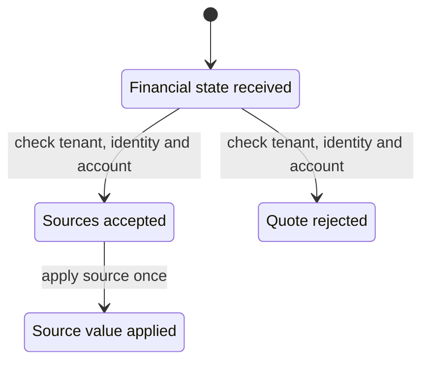
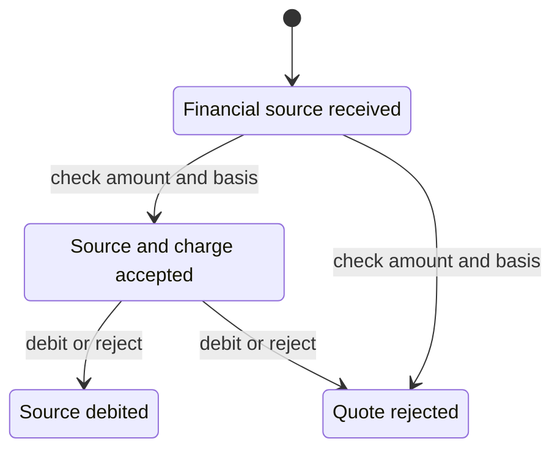
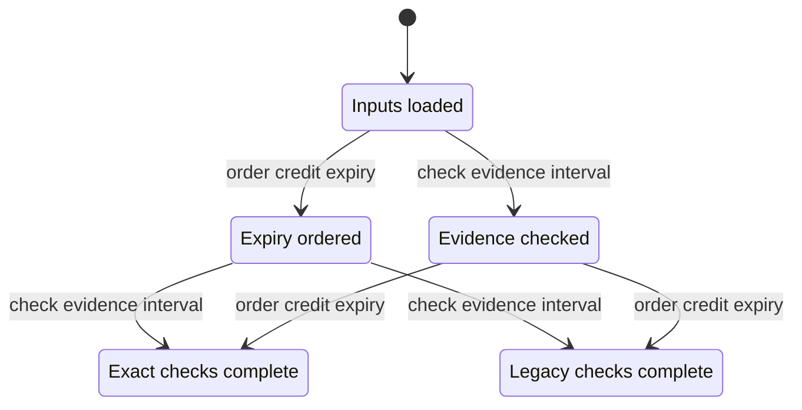
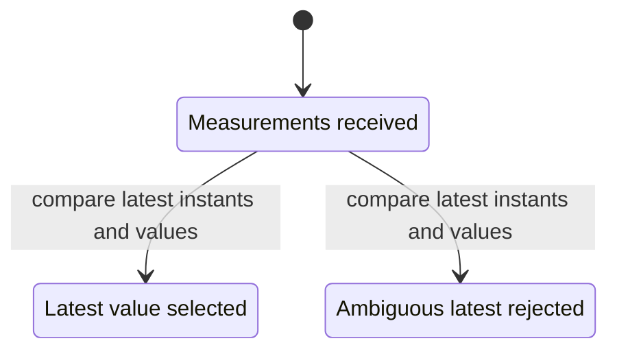
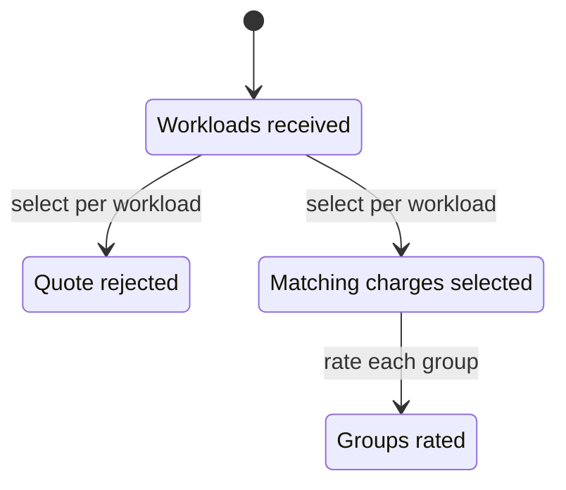
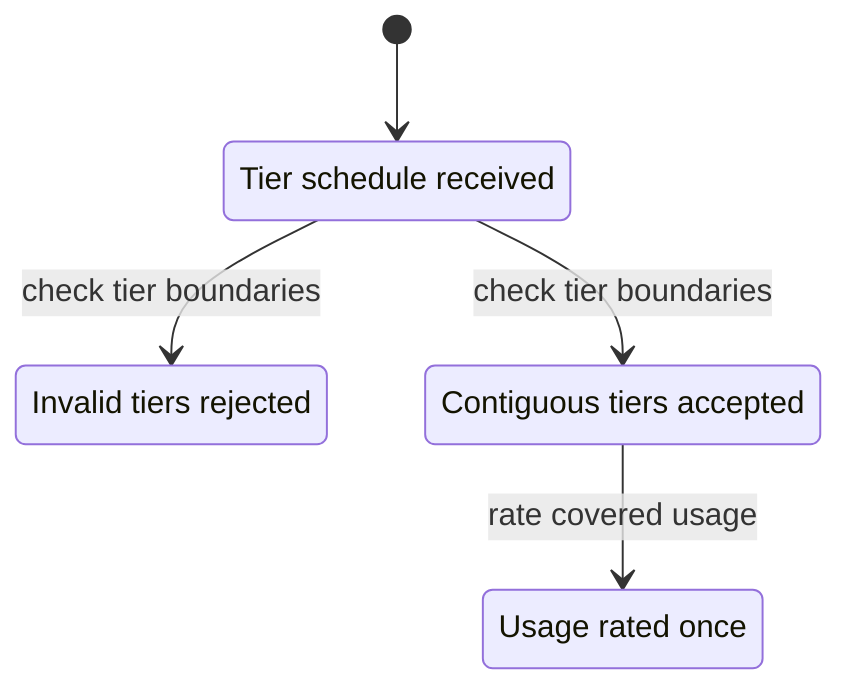
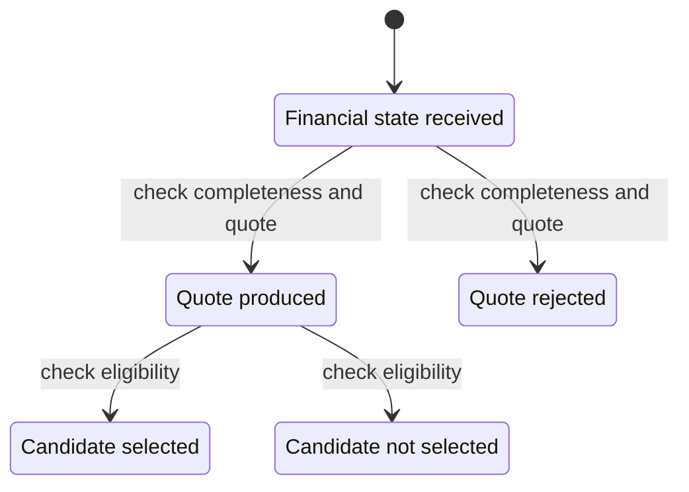

# @hobo/pricing

Pure provider-cost rating for HoBo routing and FinOps. It models provider
commercial terms only; customer billing, payments, tax, and invoices are out of
scope. The normative design is
[`docs/design/provider-pricing-commercial-terms.md`](../../docs/design/provider-pricing-commercial-terms.md)
and ADR-0176 records the package boundary.

## Pricing availability and developer-supplied models

`pricingUnavailable(reason)` represents an offering with no known model;
it never represents a zero price. `developerPricing(scope, scenario)` attaches
a developer-authored declarative `QuoteScenario` to one tenant, provider,
account and product. `parsePricingAvailability` decodes its protobuf JSON
oneof, and `quoteAvailablePricing(providerId, availability)` checks scope,
complete financial state and explicit usage for all declared meters before
rating it. The result identifies the developer model and revision, or a
machine-readable rejection. Unknown and invalid inputs do not fall back to a
different price. The single-offering model builder snapshots and validates the
scope and scenario before protobuf normalization; the quote also rejects
malformed availability messages and unknown nested fields before rating them.

This checks the scenario as declared; the model itself cannot prove that every
billable resource or charge dimension was included. A supplied model is an
estimate, not a provider-backed spending limit. The current helper handles one
product/account. A fixed-only product may omit usage meters when a fixed charge
applies to the workload. If that charge names a quantity dimension, the agreement
and each workload must explicitly declare that quantity, including zero. An
existing flat subscription can have a zero incremental quote while its baseline
cost remains nonzero. Hosting admission requires independently verified scope,
exposure bounds and a durable reservation.
`model/IacFixedPricing.tla` checks these coverage decisions for one workload
and two abstract amounts; it does not prove the TypeScript implementation.
The protobuf and CUE definitions live in `data-models/pricing.proto` and
`data-models/pricing.cue`; positive/negative CUE fixtures and
`test/availability.test.ts` exercise the new boundary.

For a target containing several resources, `createTargetPricingInventory`
describes each resource's provider, account and product, and
`targetPricingModel` binds every resource to one candidate workload in a joint
scenario. `quoteTargetPricing` rejects incomplete inventories, missing meters,
scope mismatches and oversized inputs. Every baseline workload must match a
provider, account and product in the target inventory. The joint quote rates
resources together so shared credits and commitments are counted once. For
other active agreements it also requires explicit quantities for any selected
fixed charges. An unavailable model remains explicit through
`targetPricingUnavailable`. Inventory completeness and developer-supplied
usage still need independent verification at admission.

Developer-supplied single-offering and whole-target models use
`pricing-rating/v2`, which orders identifiers by UTF-16 code units instead of
locale collation. The version is included in the quote and its hash. Callers
must use the same algorithm for their baseline entitlement calculation.
`quoteScenario` and `quoteScenarioJson` retain the v1 ordering and rating
formula, but added input, tenancy, product and selector checks can reject
historical v1 inputs. Exact historical replay requires the original
implementation. `quoteScenarioV2` is the explicit deterministic entry point
for new target pricing. Reassess and reconcile outstanding reservations before
changing the algorithm used for an existing financial operation.
V2 validates supplied UTC timestamps to millisecond precision and orders rate
schedules, grant expiries and latest measurements by instant. It rejects invalid
calendar dates, finer precision, and conflicting latest measurements at the same
instant. If different rate cards start at the same selected instant, it rejects
that ambiguity as well; input order cannot silently select a cheaper value.
V2 rejects a baseline or candidate that references a suspended or cancelled
provider agreement with `PRICING_AGREEMENT_UNAVAILABLE`. It also rejects any
agreement with an unknown status and an unreferenced trial agreement, because
their baseline liability cannot be determined. Active and past-due agreements
remain quotable; referenced trial agreements still require the applicable
new-agreement permission. An unrelated suspended or cancelled agreement does
not by itself prevent a quote. The legacy V1 behavior is unchanged.
`model/IacAgreementStatus.tla` checks this decision over one agreement and six
abstract statuses; it does not prove the TypeScript implementation or the
provider's reported agreement state.
V2 includes existing active and past-due agreements in the baseline, including
their effect on shared credits. Every selected fixed charge with a quantity
dimension requires an explicit agreement quantity and an explicit quantity on
each workload for that agreement, even when the value is zero. A missing value
returns `PRICING_FIXED_QUANTITY_UNAVAILABLE`; the developer-pricing helpers
report an incomplete model. A selected rate card with conditional fixed charges
requires a baseline workload with their selector values; otherwise V2 returns
`PRICING_FIXED_SELECTOR_UNAVAILABLE` instead of assuming no charge applies.
`model/IacSharedFixedQuantity.tla` checks a bounded
two-agreement shared-credit decision; it is not a proof of the implementation.
V2 also requires distinct, bounded IDs across financial-state allowances,
credits and commitments. Those IDs identify reservation buckets, so a model
cannot count the same bucket twice or alias different types of entitlement.
Allowance, credit and commitment balances must be present and nonnegative,
with valid currency or quantity units, even when no selected charge consumes
them. Credit acquisition and remaining/used basis amounts have the same rule.
Money credit balances, their basis, and acquisition amounts must use the same
currency. Derived credits cannot carry nonzero economic basis, and credit
consumption cannot allocate more basis than the recorded amount remaining.
Unknown or inconsistent basis terms, including nonzero recorded basis on a
zero-basis credit, are rejected even if no selected charge uses that credit.
Spend commitment amounts and balances must all use the same currency.
Each financial grant also requires an explicit scope; an empty scope means
universal, while an omitted scope is incomplete and is rejected.
`model/IacPricingScope.tla` checks this decision over a finite set of scopes;
it is not a refinement proof of the implementation or provider evidence.
Every selected rate card must have explicit charges, each with a unique bounded
ID, a base and a supported charge variant. An absent charge is incomplete;
a zero price must be expressed by an explicit zero-valued charge.
V2 checks fixed, per-unit, package and tier amounts for valid nonnegative
decimals in the rate-card currency before any charge is selected.
Tier intervals must start at zero and be contiguous without overlap. A finite
last tier is allowed, but usage beyond it is rejected rather than left unpriced;
the upper bound is inclusive for graduated pricing and exclusive for volume
pricing.
Package pricing supports positive package sizes and period rounding to whole
packages with `ceil`, `floor` or `half-up`. Event-scoped or other multiples are
rejected; aggregating events before rounding would otherwise change the price.
V2 rates one billing period at a time. A horizon reaching the next period, an
unsupported calendar anchor, or an instant before the anchor is rejected until
period splitting and the provider's renewal conventions are implemented.
Daily and weekly periods use fixed UTC durations. Monthly anchors after day 28
and yearly February 29 anchors are unsupported because rollover conventions
vary by provider. A horizon exactly at the next boundary is conservatively
treated as crossing it. Fixed charges must be one-time charges or use the
agreement's billing cadence.
An exclusive charge group must select an applicable charge. Groups spanning
different charge variants or usage dimensions are rejected until their selection
can be rated as a single decision.
For unique-count meters, V2 applies period rounding after deduplication. It
accepts event rounding only for a unit multiple, and rejects removals until the
model includes source multiplicity for values shared by multiple workloads.
V2 reports spend-commitment consumption in the rate-card currency. Callers must
require that currency for credit and commitment consumption before converting
those claims to ledger micros.
V2 refuses rebalancing, migration and cancellation scenarios, candidate
removals, and source agreement references until source-side obligations, fees
and any allowed refunds can be included in the amounts used for routing and
budget admission. A cancellation denied by policy remains denied. For inputs
that it accepts, V1 retains its former source-action calculation; it is not
sufficient for new budget admission.
Whole-target pricing requires a separate `action: "destroy"` scenario for a
destroy operation. It must explicitly set `destroyCancelsAgreement: false`,
have no source agreement IDs, and represent all destroy charges as added
workloads; removal savings and agreement cancellation are unsupported. The
host must independently verify that declaration and the complete liability
bound. A placement estimate cannot stand in for a destroy quote. An absent
model remains unavailable; any unpriced operation requires explicit host policy.
`model/IacDestroyPricing.tla` checks these finite assessment and admission
choices, including explicit unpriced authorization. It assumes host authority
results and does not prove the implementation or provider effects.
The pricing CI workflow runs the pricing, broker, routing, events and provider
manifest suites as well as the bounded pricing models when their inputs change.

The target model builder validates the bounded generated scenario and binding
data before protobuf normalization: unknown fields, nonempty unknown wire
fields, accessors, exotic prototypes and data that would be discarded are
rejected. Use generated messages or strict JSON parsing, and omit optional
fields rather than setting them to `undefined`. A malformed declared model is
an error, never an unavailable-pricing opt-in.
The inventory builder likewise rejects unrecognized fields and inaccessible
or proxied input before normalization. JavaScript may allocate while
enumerating object keys before a traversal limit can be checked, so hosts must
apply independent process memory and time limits to untrusted inputs.

Pricing requires a supported JavaScript realm. `isSupportedPricingRealm()`
checks the standard `Object.prototype` and the captured reflection functions:
additional prototype properties, including data properties and benign
polyfills, can affect absent protobuf fields or dynamic quantity and attribute
lookups. The supported Node hardening modes that remove `__proto__` or freeze
intrinsics are accepted. An unsupported realm produces
`PRICING_REALM_UNSUPPORTED` from quote assessments; constructors throw a
specific `TypeError`, and parsers that return `undefined` can be distinguished
by calling `isSupportedPricingRealm()`.

The host must initialize pricing with trustworthy Node intrinsics, prevent
untrusted mutation of other global and array intrinsics throughout a call, and
bound the process resources used by its realm. The guard compares against the
functions captured at import; it cannot authenticate an intrinsic replaced
before import, and enumerating an already-expanded global prototype allocates
in proportion to that prior mutation. Pricing calls are synchronous and check
the realm anew on each call; a host must reassess after an external callback
before relying on a quote. `developerPricing` snapshots its bounded inputs
before passing them to protobuf.

`assessTargetPricing(inventory, availability)` returns that same joint quote
and a `providerCoverage` view grouped by the declared provider IDs. Each
provider is `quoted` only when the complete target was quoted; `unavailable`
means no target model was supplied, `incomplete` identifies missing or invalid
resource bindings, and `unverified` means the joint quote failed for another
reason. A `declared` binding establishes only the presence of a candidate, not
that its rate or account evidence is valid. If the inventory itself is invalid,
the coverage basis is `unavailable` and no provider list is inferred. Shared
credits are not split into invented per-provider prices. These are assessments
of the declared target and developer model; they neither authenticate the
inventory nor evaluate or reserve a budget.

## Batch 2 surface

`QuoteEngine.quote(scenario)` (also available as `quoteScenario(scenario)`)
accepts the generated `QuoteScenario` protobuf type and returns
`QuoteVector | PricingRejected`. It rates fixed and usage charges, allowances,
paid/promotional credits, and provider-actual spend commitments. Baseline and
candidate snapshots use the same pinned state; incremental amounts are
`F(baseline + candidate) - F(baseline)`.

Every baseline and candidate workload must name its agreement's product;
a mismatch returns `INVALID_PRICING_INPUT` rather than rating a different
product's usage against that agreement. Through `pricing-rating/v5`, rating
aggregated workloads by provider agreement and returned
`PRICING_MODEL_UNSUPPORTED` when two workloads in a snapshot had different
values for a selector used by that agreement's rate card. Versions 1–5
retain that aggregated behavior; the v2 target and availability surfaces
keep the check.

New quotes use `pricing-rating/v9`. It orders ties by string code units,
compares UTC instants without truncating fractional seconds, rejects impossible
calendar dates, and requires each allowance, credit, and commitment to have a
unique nonempty identity within its kind and the financial state's tenant. This
also requires a provider account on each agreement and rejects financial sources
in any state containing agreements for more than one account: grants currently
have no field identifying their account. This conservative check includes unused
and inactive agreements. It cannot establish that the supplied identities and
tenant truly correspond to provider records. The change to the algorithm version
and quote hash can change credit, rate-card,
or latest-observation choices. To rerate an old record, pass its stored version, for example
`quoteScenario(scenario, { ratingAlgorithmVersion: "pricing-rating/v1" })`.
Version 1 used locale-sensitive ordering, so reproducing an old tied quote also
requires its original locale. Versions 1 and 2 also retain their previous
timestamp comparison and millisecond validation behavior. Versions 1–3 do not
enforce the new source identity checks. Versions 1–4 also retain earlier source
amount, basis and commitment-unit behavior. Versions 1–5 retain earlier
workload-selector and meter behavior. Versions 1–6 also retain the earlier
handling of conflicting latest measurements. Preserve the original quote as evidence
rather than treating a new v9 quote as the old one, and reconcile affected old
expiry, evidence, observation, and financial-source decisions before use.

V9 marks quotes from explicitly allowed partial financial states as
informational and ineligible for automatic selection. Unknown completeness
values reject. Dispatcher v2 also requires explicit positive eligibility.
Versions 1–8 retain their prior eligibility on replay; reconcile old quotes
before using them for decisions. The broker's separate raw-estimate helper
does not receive a quote or its eligibility and requires trusted caller checks.

V8 requires graduated and volume tier schedules to begin at zero, increase,
and have neither gaps nor overlaps. A missing intermediate end is inferred
from the next tier's start. A finite final graduated tier cannot rate usage
beyond its end; a finite volume tier excludes its upper endpoint. Versions 1–7
retain the previous tier behavior for historical replay.

V6 selects charges for each workload and groups matching measurements for each
charge before applying its pricing model. A workload's product must match its
agreement, each measurement must have a product meter, and meter dimensions and
charge IDs must be present and unique. The earlier algorithm selected charges
from the first workload and could apply its price to other workloads, or ignore
an unmetered measurement entirely.

V7 rejects a `latest` meter when different quantities share its latest instant.
Equal quantities are accepted after unit conversion and event-level rounding;
conflicts at older instants do not prevent selecting a later value. The input
must supply enough ordering information to distinguish conflicting observations.

V5 requires nonnegative source amounts and rate-card prices and compatible units.
For allowances and credits it bounds used plus remaining by the declared amount plus rollover; for
forfeiting commitments it bounds them by the declared amount. These checks treat
used and remaining as belonging to the same grant and bucket. Derived credits
must have no additional basis, and consumed credit basis cannot exceed recorded
remaining basis. Paid-credit rollover and commitment rollover or true-up fail
closed because their carried basis or bucket semantics are not represented.
Commitment consumption is recorded in its currency. These checks do not verify
that the provider's reported capacity, prior usage, or basis is authentic.

- Exact decimal strings and scaled-integer arithmetic; no floating-point money.
- Explicit unit identities/conversions; GB and GiB are never treated as aliases.
- Complete, current evidence is required through the quote horizon.
- Exclusive charge groups, currency mismatches, stale observations, unknown
  terms, and unsupported external rating fail closed.
- Credits sort by priority, earliest expiry, then grant ID. Derived credits have
  zero additional economic basis; purchased-credit basis is allocated pro rata.
- Upfront provider-actual commitments support billing-period and single-UTC-hour
  buckets; cross-hour consumption fails closed.
- No wall clock, network, environment, or live provider calls. V2 ordering
  does not depend on locale; v1 retains its historical locale collation.
- New agreements are denied unless explicitly enabled. Cancellation also
  requires explicit permission; V2 currently refuses it even when permitted.

`@hobo/pricing/legacy` exports the moved CI allocation and sandbox translators.
Their function bodies are unchanged, and `legacy_ci.proto` mirrors the two
CI-owned protobuf records with identical type names, fields, and wire numbers.
The CI package preserves its original imports through thin re-exports.

`ExternalProviderQuote` is an evidence record, not an executable pricing model.
`external-quote.ts` always rejects attempts to turn one into a rating engine.
Dispatcher v1 is unchanged; v2 lives in `@hobo/dispatcher` as
`decideDispatchV2`. Legacy CI sandbox accounting re-exports from
`@hobo/pricing/legacy`. Broker quote authorization and cloud commercial catalog
hashes integrate without changing dispatcher v1 replay.

## Phases 2–5 surface

- **`@hobo/pricing/legacy`**: moved CI decimal accounting (`allocationQuote`,
  `divideDecimalAtMost`); `@hobo/ci` re-exports preserve import paths.
- **`decideDispatchV2`**: ranks registered providers by minimum incremental
  billed amount from `quoteScenario`; v1 `decideDispatch` is byte-identical on
  the pinned replay fixture.
- **Adversarial §13**: fixtures 10.1–10.11 (including stale observation,
  cross-currency, and zero-incremental tie cases).
- **`pricing.*` events**: pinned v1 corpus entry for `pricing.QuoteCreated` in
  `@hobo/events`.
- **Broker / cloud**: `authorizeBillingSpend` prefers quote incremental USD;
  `pricingCatalogHashFromCommercialRefs` hashes commercial product refs without
  altering resource `catalogHashOf`.
- **`@hobo/pricing/sync`**: offline provider billing sync adapter (§12 Phase 5).
  Imports FOCUS-shaped rows through a `ProviderBillingPort`, dedupes by provider
  charge id, emits dated `hobo.pricing.billing-sync.snapshot/v1` snapshots,
  variance facts, and `ReconciliationRecorded` events. Fail-closed on partial
  provider data; never imported by the pure quote kernel.

## Contracts and validation

`data-models/pricing.proto` is the canonical record source. TypeScript messages
under `src/_generated/` are generated, never hand-edited. `pricing.cue` pins
decimal syntax, UTC billing periods, exclusive groups, and derived-grant basis;
valid and invalid JSON fixtures exercise those constraints.

```bash
pnpm --filter @hobo/pricing run codegen
pnpm --filter @hobo/pricing run test:schema
pnpm --filter @hobo/pricing run test:contract:consumer
pnpm --filter @hobo/pricing run test
```

The replay corpus pins complete v1 through v8 quote outputs. The replay test parses
each scenario through protobuf JSON, rerates it with the recorded version, and
compares the stable JSON result, including the quote hash. The quote-boundary
PACT is a hand-authored consumer expectation; no live provider accuracy is
claimed.

## Credit-order verification

The [pricing financial-source skill](../../.agents/skills/verify-pricing-credit-order/SKILL.md)
checks source admission and the equal-priority credit flow against real code,
bounded TLA+ models, and abstract balance proofs. The credit model explores 72 states and hides eighteen
same-state transitions; a separate counterexample shows that legacy v1 quotes
can differ by locale.



The source-admission projection covers one abstract financial source. Its
model explores 441 states and hides 192 same-state transitions; it assumes the
source identity, tenant, and account classifications reflect the provider's
actual records.



The source-value model checks debit bounds, credit basis and commitment units
over 2,004 states. This projection constrains inputs to 254 states and hides 96
same-state transitions. The model treats remaining capacity after prior use as
an input and assumes the source amounts and unit conversions are correct.



## UTC verification

The [pricing time skill](../../.agents/skills/verify-pricing-time/SKILL.md)
checks UTC validity, evidence coverage and time ordering. Its model explores
256 states and hides 64 same-state transitions. `parseUtc` returns milliseconds;
use `compareUtcExact` when fractional ordering matters.



The latest-measurement model checks both input orders for two abstract
observations across 64 states and hides 32 same-state transitions.



## Workload selector verification

The [pricing selector skill](../../.agents/skills/verify-pricing-selectors/SKILL.md)
checks per-workload selection, grouped rating and meter binding. Its selector
model checks 608 states; this constrained projection checks 152 and hides 64
same-state transitions. A separate binding model checks 64 states.



The tier coverage model checks 192 states for two abstract ranges and hides 72
same-state transitions. It assumes an unbounded final tier; implementation
tests also cover finite endpoints and inferred intermediate ends.



## Financial completeness verification

The [pricing eligibility skill](../../.agents/skills/verify-pricing-eligibility/SKILL.md)
checks the quote and dispatcher gates. Its model explores 62 states and hides
24 same-state transitions; it assumes the reported completeness is truthful.



## Architecture boundaries

Parse, don't validate starts at `parseJson` and `parseQuoteScenario`: untrusted
JSON becomes a generated `QuoteScenario` before rating. `parseDecimal` derives
the scaled-integer `Decimal` parsed type, and rating functions accept generated
messages plus these derived domain types rather than raw DTOs.

The quote kernel remains a pure query, so it has no command handler, actor,
event-store write, materialized view projection, persisted snapshot, or read store.
`rateSnapshot` builds only an ephemeral rating snapshot and never mutates a read
model. The declared `pricing.*` events belong to later actor integrations; those
integrations must consume commands, append events to an event store, and build
materialized-view projections and snapshots in a read store outside this pure
rating path.
