# @hobo/runtime

The **SDK runtime-primitives package**: app-facing authoring surfaces and the
deterministic-replay library that backs them.

- **Trainable methods (ADR-0025 / ADR-0125)** — `training(fn, opts)`,
  signature-only `training.define()` empty implementations served by a
  contract-derived stub (`defineGrounding()` is the same function under the
  name the registrations call that `hobo stub` generates for an ambient
  `@trainable declare class`, in `src/_generated/declared/<Class>.ts`;
  ADR-0128), the optional `@trainable` class decorator and `@intent` method
  decorator (including projects using `exactOptionalPropertyTypes`),
  the `"use training"` grounding lint, and `applyTrainingArtifact()` for
  apply-at-load promotion. See `src/training/`. The JSON types this surface
  is typed in (`JsonValue`, `JsonObject`, `JsonBag`) are exported from the
  root too, so a generated module whose exports infer `Trainable<JsonValue,
  JsonValue>` compiles with `declaration: true`.
- **Deterministic replay** (`./replay` export) — the replay/divergence/
  equivalence engine (ADR-0086), promoted from the
  `deterministic-replay-engine` draft proof (frozen in
  `scripts/promotions.json`).

## Naming: `runtime` vs `runtimes/`

These are different concerns that share a word:

- **`packages/runtime` (`@hobo/runtime`, this package)** — the *SDK
  primitives* layer app code imports (`import { training } from
  "@hobo/runtime"`); no I/O, no substrate.
- **`packages/runtimes/*` (e.g. `@hobo/runtime-local`)** — concrete *runtime
  backends* implementing the durable runtime ports (EventStore, Queue,
  Clock, component host) for a substrate. `runtime-local/src/replay.ts` is
  that backend's record/replay **link mode** (ADR-0076), not this package's
  replay engine.

The glossary's "Runtime" entry records the same disambiguation.

`WorkflowFailure` preserves an omitted step or cause as `undefined` rather than
manufacturing placeholder values.

## Durable workflows

Fresh workflows claim a new journal atomically before user steps execute. Generated IDs use random UUIDs; a host that needs the ID to recover after a crash can pass `{ runId }` to `start` and persist that ID first. A duplicate ID is rejected, assuming the event store enforces its expected-sequence compare-and-set.

Workflow input must be an ordinary JSON tree. The engine captures a detached
input before the first asynchronous operation and passes that capture to the
workflow on start and resume, so later caller edits cannot change journal-bound
work. Values such as `undefined`, `NaN`, `-0`, `Date`, `BigInt`, maps, shared
or circular references, sparse arrays, proxies, accessors, hidden properties,
and frozen or non-extensible objects are refused. Objects and arrays must have
their standard prototypes and ordinary writable, enumerable, configurable data
properties; arrays must have only their indexed elements. Validation inspects
properties without invoking getters. Convert other inputs to explicit JSON values
before starting or resuming a run.

The input-capture model explores 18 states and 34 steps. This five-state
projection hides 22 same-label steps, including caller edits, and assumes the
JSON conversion and equality check correctly identify reproducible values.

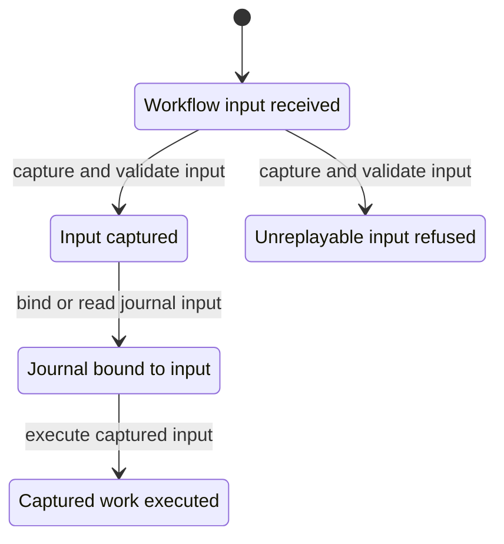

An explicit run ID must be a nonempty primitive string for `start`, `resume`,
and `journal`. Omitting the ID on `start` generates one; explicitly passing
`null`, an empty string, a number, or an object is refused. This keeps the local
execution-fence key and the journal stream identity consistent.

The run-identity model checks 13 states and 20 steps for a running string ID,
another string ID and several invalid values. Its projection hides 13
same-label steps and assumes the two executions share the same local fence.

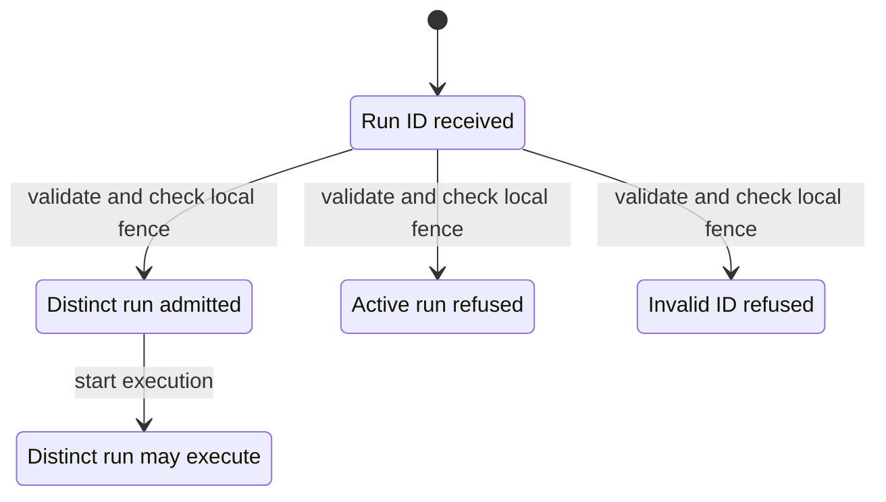

`resume` requires an existing `run.Started` and the original JSON-normalized input. Every `run.Started` must contain the input and a nonempty workflow name and seed; a record missing any of them, or carrying an unknown field, is refused. New definitions and engine seeds require nonempty primitive strings. Start, resume and replay adapters capture the definition's name, callback, tool bindings and capabilities before waiting, although the application callback and its external state remain trusted. Completed journaled steps are reused; a recorded `run.StepFailed` replays as failure without re-running the step. An external effect can repeat if the host crashes after the effect and before recording its completion. See the [workflow replay verification skill](../../.agents/skills/verify-workflow-replay/SKILL.md).

`replayRun` requires the recorded input, workflow name and seed and checks
them. An explicitly supplied seed must match the recorded seed. Replay captures input, options, and callback references
before waiting for the journal. Workflow callbacks and the journal remain
trusted; a callback can still read mutable application state, and a matching
workflow name does not identify a specific code version. The replay report
contains the resulting state digest but does not automatically compare it with
the recorded terminal result.

The replay-binding model explores 42 states and 76 steps. This five-state
projection hides 50 same-label steps, including caller edits, and assumes the
journal observations and snapshot operations are truthful.

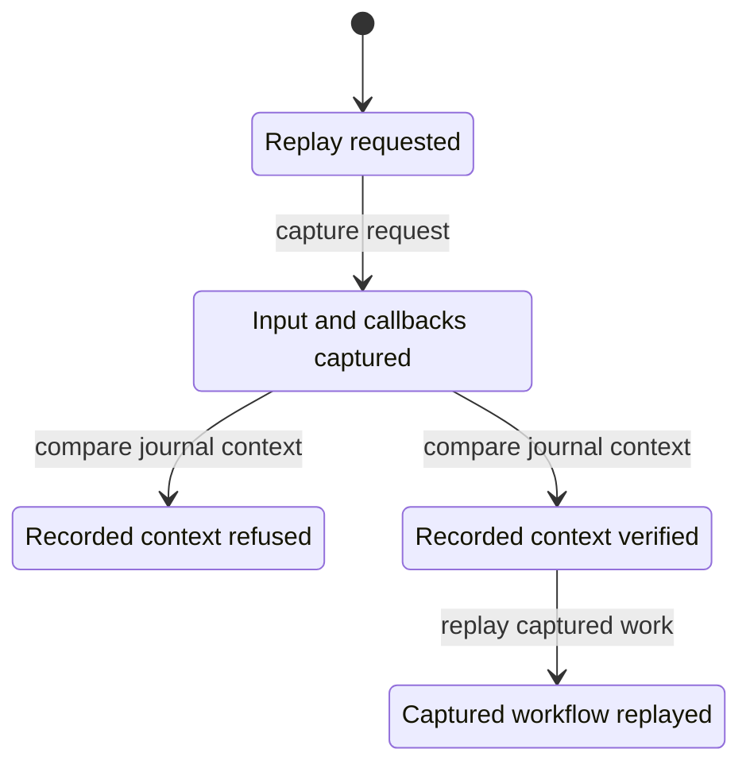

`assertReplayEqualsLive` synchronously runs a fold with different `Date.now`
and `Math.random` values, then restores their original property descriptors,
including if setup or the fold throws. Those temporary overrides affect any
synchronous code called by the fold. They cannot detect all nondeterminism,
such as `new Date()` or reads from external state, and callbacks must not make
the intrinsic properties impossible to restore.

Replay sequence vectors retain stream IDs such as `__proto__` and
`constructor`; an explicit target vector uses only its own string entries,
including non-enumerable ones. The harness captures their values once before
filtering events and captures the supplied events before running either fold,
so caller edits during a fold cannot change the reported boundary or read set.
Event sequence numbers and target limits must be non-negative safe integers;
replay refuses an unsafe journal sequence before calling workflow callbacks.
Replay report parsing also rejects unsafe positions. The values remain trusted
as observations of the underlying event store.

Stream IDs, report run IDs and seeds must be nonempty primitive strings;
parsed evidence also requires primitive strings in its other string fields.
Resume, replay and journal reads refuse records returned for a different
run's stream before using them. This checks the reader's returned identities;
it does not authenticate the journal or prove that its contents are complete.

Replay reports and divergence records use locale-independent UTF-16 ordering
for keys and event identifiers, so equivalent JSON objects do not acquire
different digests when the machine locale or insertion order changes.

Use `parseReplayReportProtoJson` or `parseReplayDivergenceProtoJson` for
protobuf JSON, and `parseReplayReportBinary` or `parseReplayDivergenceBinary`
for protobuf bytes. These adapters restore omitted empty arrays, accept exact
safe `uint64` sequence positions, and apply the same domain checks as the
strict parsers. The binary adapters also reject overflowing varints and
deprecated protobuf groups. Unknown ordinary binary fields remain allowed.
The adapters capture inputs before validation; JSON accessors, proxies, cycles,
sparse arrays and nesting deeper than 100 are refused, while frozen ordinary
JSON values are accepted. Binary decoding uses a detached copy of the bytes.
JSON numeric values are checked as received; a number already rounded before
the adapter receives it cannot be recovered, so use protobuf JSON strings for
large integer positions. These checks do not authenticate the evidence.
Replay reports freeze their fields, sequence vectors and entries. Divergence
records also capture and freeze their order arrays, so later caller changes
cannot alter the evidence. Their TypeScript fields are readonly.

Within one loaded runtime module, `start` and `resume` refuse another active
execution with the same run ID and the same `EventStoreWriter` object, even
when different engine instances share it. If a parent exits with a durable
command still running, the local fence remains until that command settles;
an indefinitely pending command therefore keeps the run unavailable in that
process. Different writer objects, workers and processes still require
host-side fencing, even if they address the same database. Direct effects
outside the tracked workflow commands are not covered.

Within one execution, journal appends are serialized even when workflow steps
run concurrently. If an append fails or its result is uncertain, later appends
in that execution fail with the same error; use a fresh `resume` to reread the
durable journal. An effect already authorized before the failure may still be
running, and separate executions are not fenced by this queue. The local
execution fence described above covers shared writer objects only. A journal at
`Number.MAX_SAFE_INTEGER` cannot accept another event until its sequence format
is migrated; invalid or exhausted sequences fail before the next step runs.

The local-execution model explores 16 states and 40 steps. Its four-state
projection hides 16 same-label steps and assumes the attempts share the same
writer object and loaded runtime module.

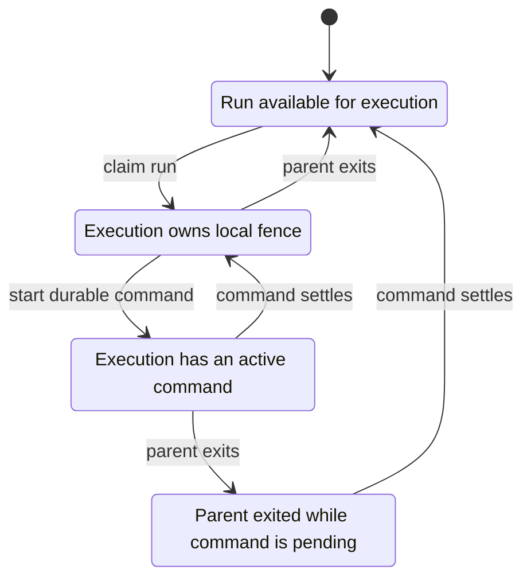

Workflow and step results must be ordinary JSON trees or top-level `undefined`.
Dates, non-finite numbers, shared or circular references, accessors, proxies,
sparse arrays, frozen objects and other values that cannot be faithfully
replayed are refused. Results are captured before storage waits, so later edits
to the original do not change the first returned value. An unsupported result
raises a workflow failure; an unsupported step result also records a step
failure. A journaled `run.StepFailed` replays by rethrowing that failure without
re-running the step effect. Convert other values to explicit JSON.

The [workflow replay verification skill](../../.agents/skills/verify-workflow-replay/SKILL.md)
includes statecharts and bounded models for input and result capture. They
check 18 input states and 15 result states, including start and resume input
isolation (mutation checks on those capture sites), edits around journal
writes, and restarts. A 16-state model checks run-ID validation.

A missing earlier step outcome is accepted only when that step was scheduled;
this permits recovery when parallel steps finish out of order. Replay validates
the recorded name before running the unfinished step and reuses later saved
outcomes. A workflow may catch a step failure, perform compensating steps, and
complete. Replay rethrows the saved failure into the workflow so it can take
the same path. The workflow cannot record either terminal state while a prior
outcome remains unconsumed. The bounded models check these paths and guards.

Resuming a completed or failed run returns its recorded terminal outcome without
calling the workflow or appending another event. An unawaited step
aborts the execution before a terminal fact is written, so it cannot corrupt a
sealed run. A journal with multiple
terminal facts is rejected before returning an outcome. Before execution or replay,
a journal must start with exactly one `run.Started`, have contiguous
safe-integer sequences beginning at one, have no record after a terminal
outcome and contain no unknown reserved `run.*` records. The command tree is
validated and missing completion evidence is refused. A damaged history may need reconciliation;
`journal()` remains available to inspect it when the stream identity matches.

The journal-history model checks 298 bounded states. This projection hides 144
internal steps that do not change a displayed state.

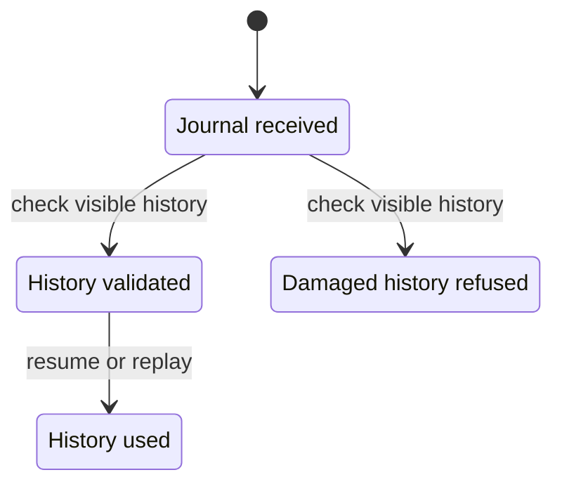

Application `ctx.emit` event types cannot begin with `run.`; those names belong
to the workflow engine. New journals include command identity in each emitted
event's metadata. Resume and parent retries reuse a committed event and return
its original sequence, including when the write response was lost. Changed
event type, payload, or order aborts the execution. The event store must
preserve this metadata and provide atomic expected-sequence writes. SQLite
normalizes a null event payload to `{}`; the metadata preserves the original
command value for recovery.

The journal and its writer are trusted: records written by another writer
cannot be authenticated retroactively. A truncated tail or records that a
reader has removed and renumbered cannot be detected from the visible prefix
alone.

The event-recovery model explores five distinct states. Its projection hides one
internal transition that does not change the displayed state.

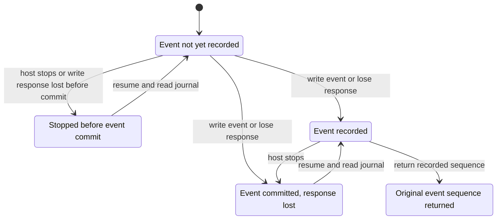

The journal-authority model explores 10 distinct states. Its projection hides
five internal transitions that do not change the displayed state.

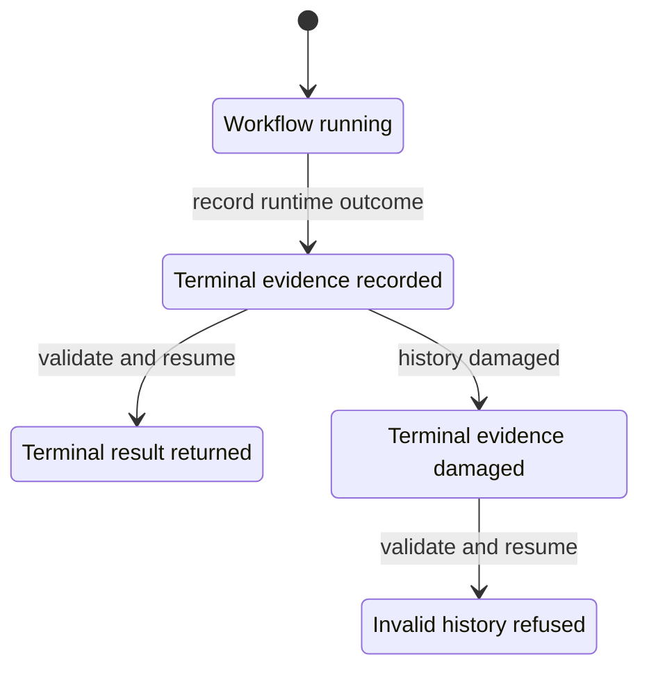

Replay checks each recorded sleep in order and refuses missing, changed, or
unused sleep records and unused completed steps. Existing sleep records without
an index are read in journal order; indexed records must also match their
position. Resume checks previously recorded step and sleep commands before
continuing, and a changed or shortened history aborts the execution even if
application code catches the error.

Journals record the parent of each step or sleep, including across
concurrent step bodies. Resume matches commands in order within each parent,
reuses completed nested steps and sleeps, and replays recorded step failures.
Retries of a parent reuse completed child commands. Replay can use a completed
parent when nested steps have outcomes and nested sleeps have completion facts;
it refuses children that were unfinished when the parent ended. Histories also
include `ctx.emit` commands in each parent's ordered history. A step or sleep
recorded without a parent belongs to the root.

Await `ctx.step`, `ctx.sleep`, and `ctx.emit` before returning from
their parent. If a parent finishes with one of these commands still pending,
the execution aborts without writing a terminal result and refuses further
queued journal writes. A callback that retains a closed asynchronous parent
scope cannot start another command. A storage write or external effect already
in progress may still finish, so the host must account for it before resuming.
These checks do not control arbitrary effects performed directly by workflow
code or callbacks invoked from an unrelated asynchronous context.

The nested-resume model explores 72 distinct states. Its projection hides 111
internal transitions that do not change the displayed state.

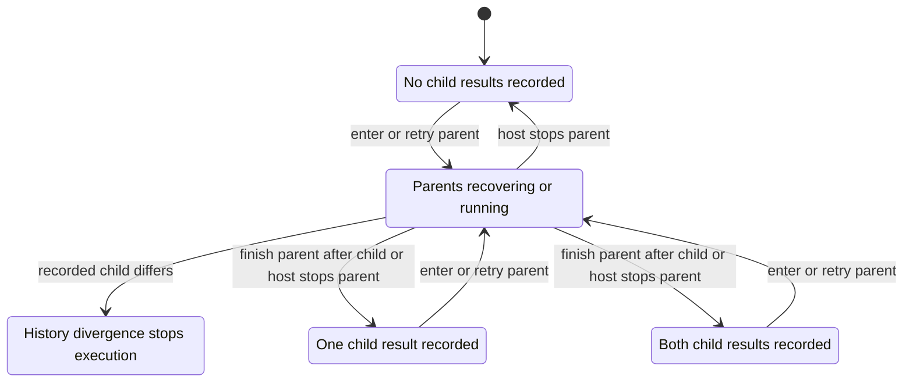

The command-lifetime model explores 14 distinct states. This projection hides
11 internal transitions that do not change the displayed state.

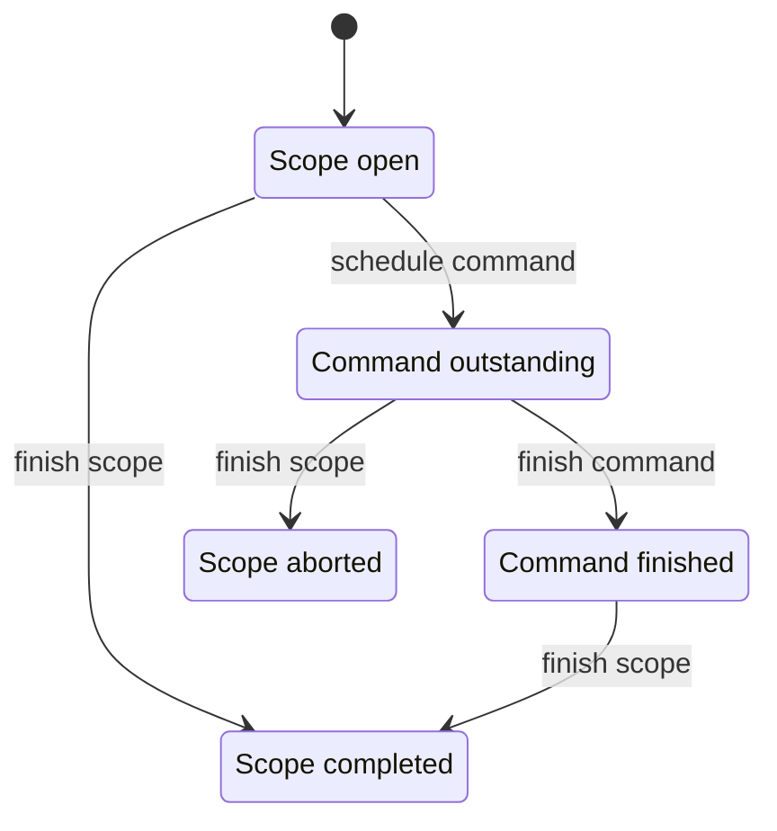

`ctx.sleep` records its deadline before waiting, rechecks the clock after
each wake-up, and records completion after the deadline. If a host stops, an
explicit `resume` uses that same deadline and reuses a completion that was
committed before a response was lost; time spent offline counts toward the delay.
New-format replay rejects missing, duplicate, or early completion evidence. A
running host uses Node timers by
default. Tests and other hosts can supply `clock` and `wait` to the workflow
engine; the clock must report accurate nonnegative integer milliseconds and
the waiter must eventually return. The host must arrange recovery and call
`resume`: this engine does not automatically discover or wake stopped runs.
Concurrent resumes through separate writers or processes require host-side
fencing.

The sleep-completion model explores 12 distinct states. Its projection hides nine
clock and other transitions that do not change the displayed state.

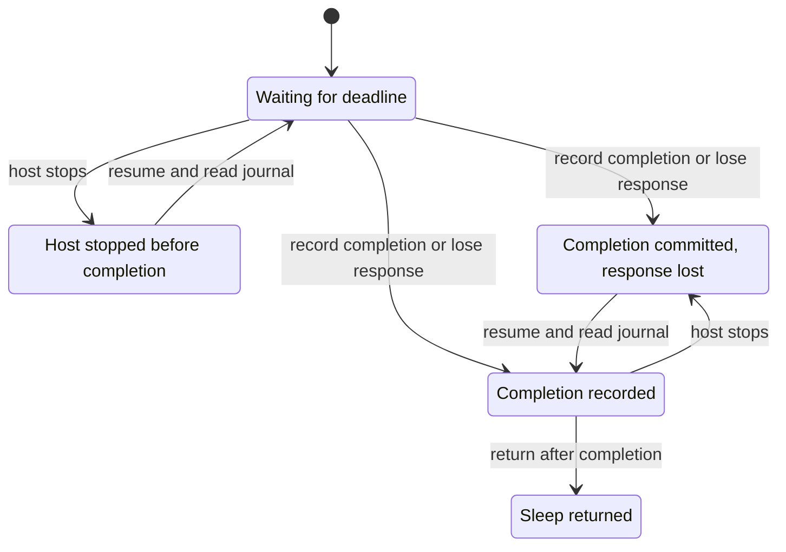

Every `run.SleepScheduled` record carries its scheduled time and deadline; a
record without them is refused.

The terminal-outcome model explores 15 distinct states and 18 transitions.
The verification runner also checks that a resume which writes a second
terminal fact violates the model's invariant.
This projection hides ten transitions that do not change the displayed state;
it shows the modeled flow, rather than a trace of one execution.

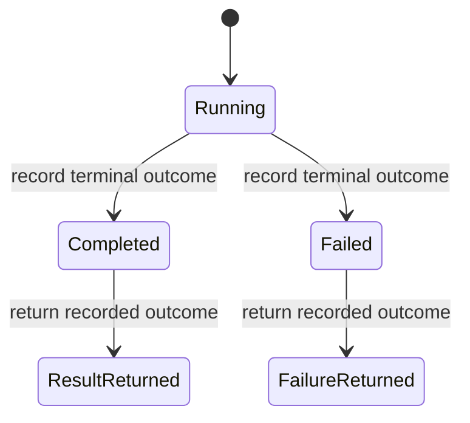

The timer replay model explores 120 distinct states. This projection hides 53
transitions that do not change the displayed state.

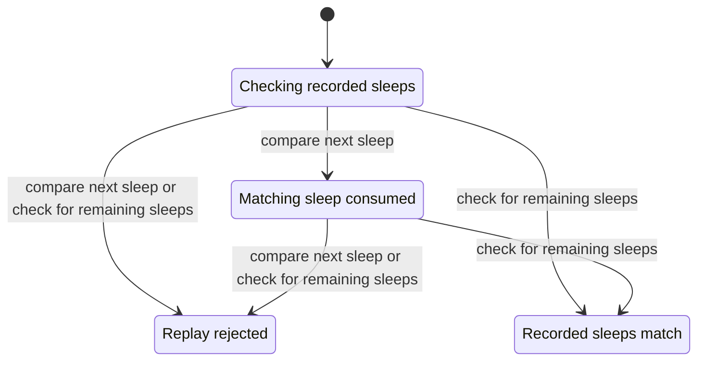

The sleep-deadline model explores 22 distinct states. The projection hides 20
clock or wake-up transitions that do not change the displayed state.

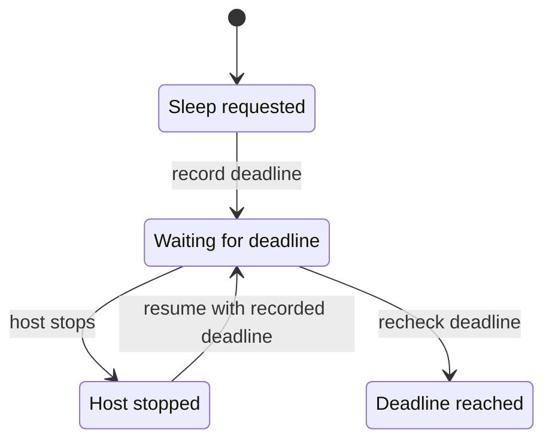
