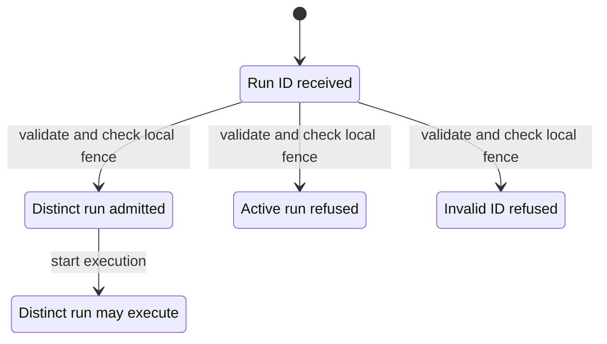
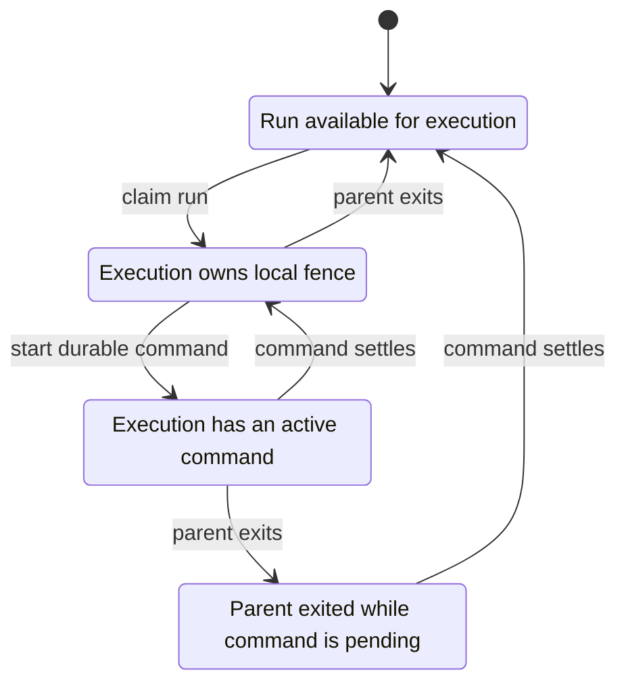
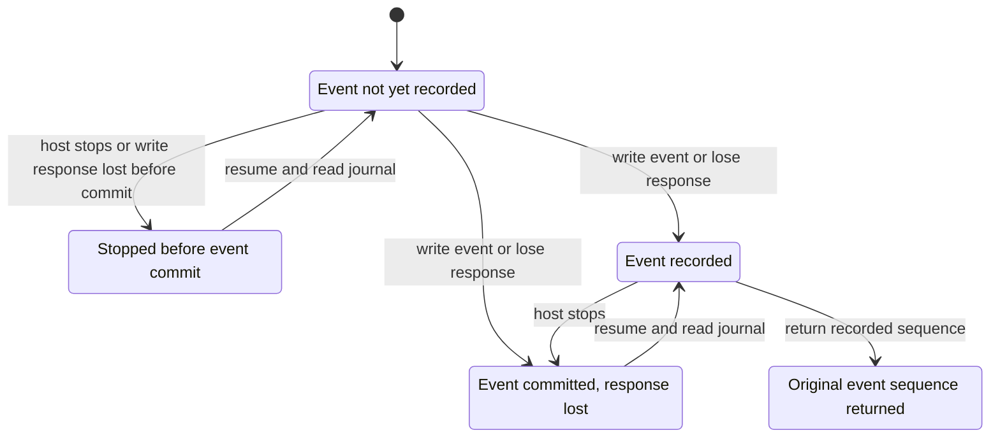
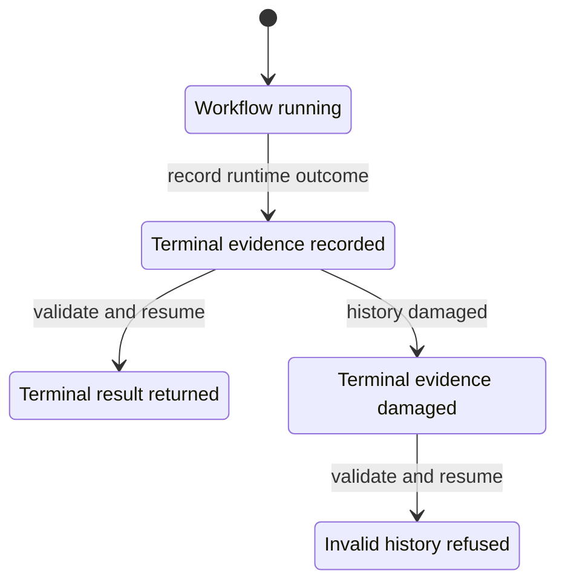
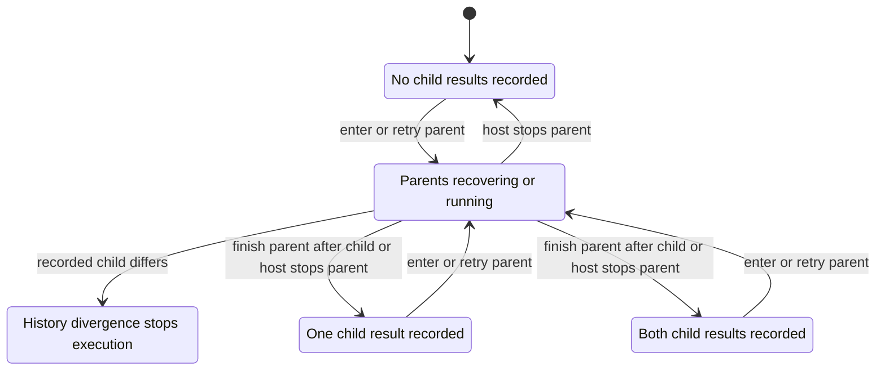
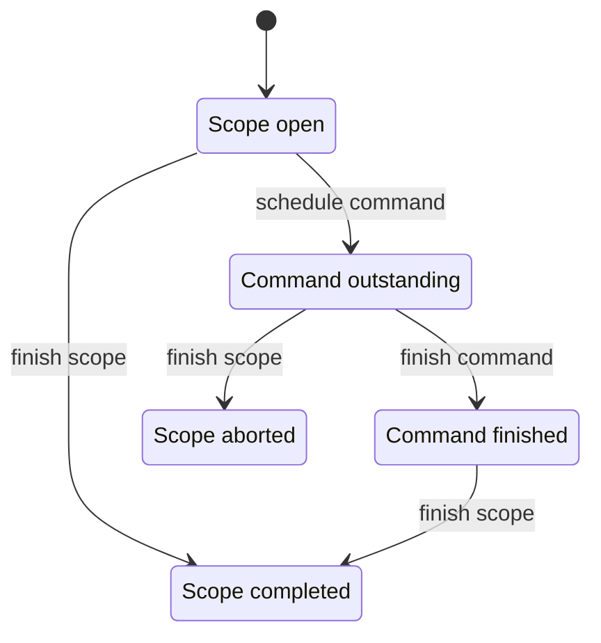
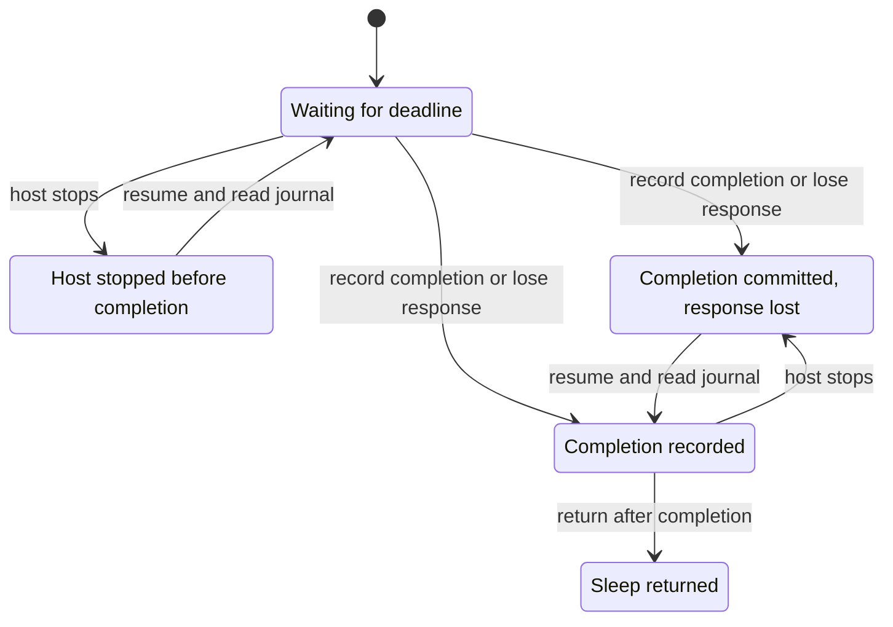
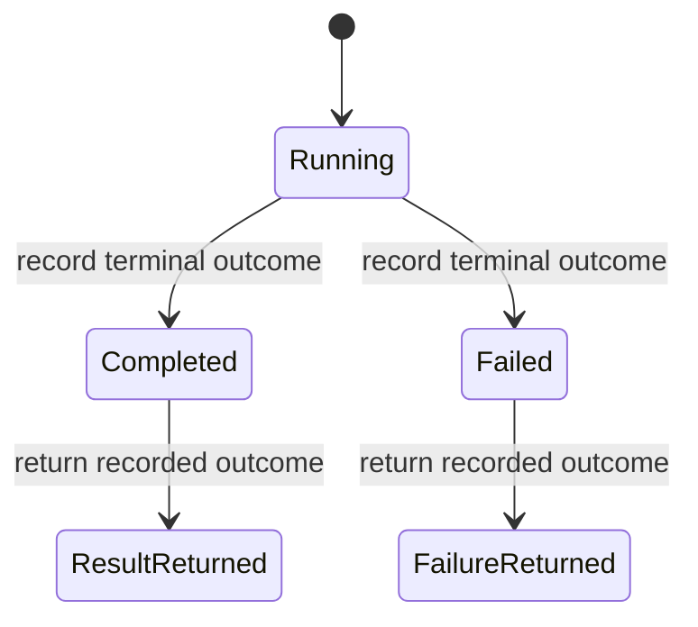
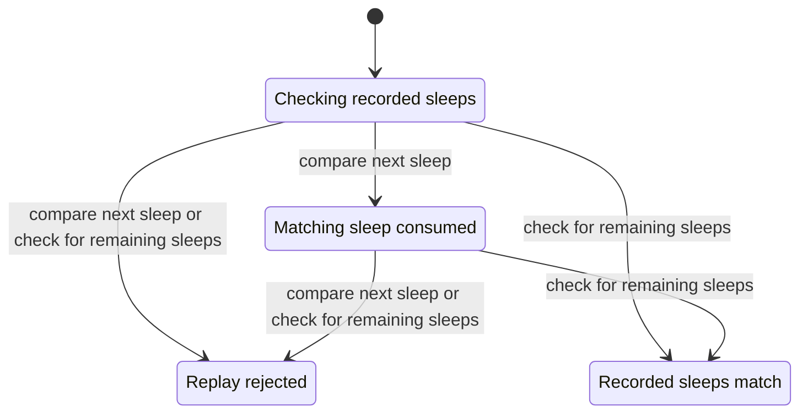
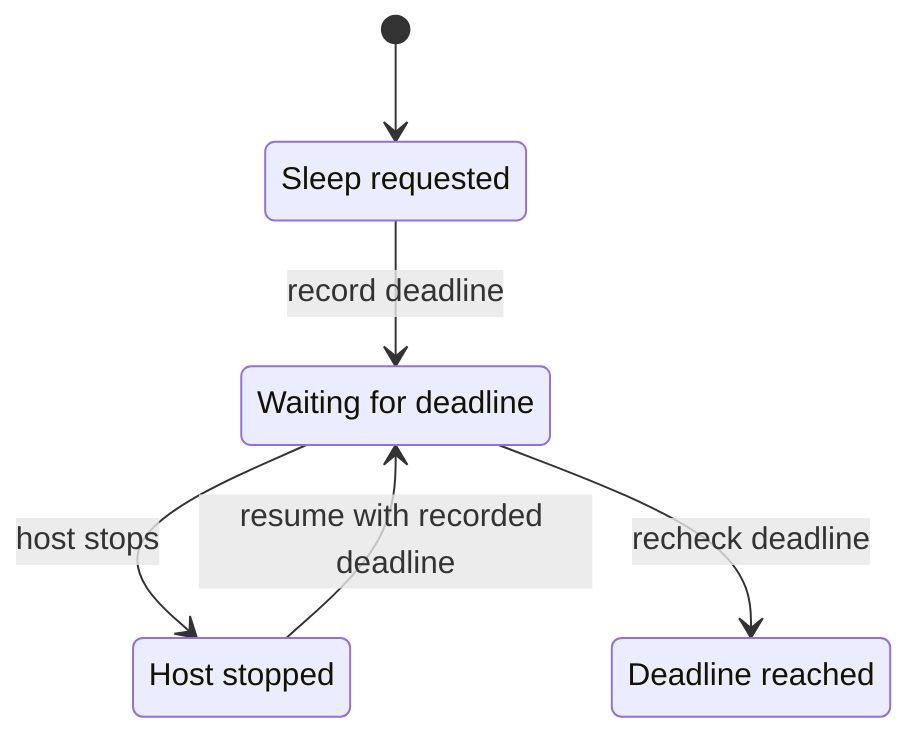

# @hobo/runtime

The **SDK runtime-primitives package**: app-facing authoring surfaces and the
deterministic-replay library that backs them.

- **Trainable methods (ADR-0025 / ADR-0125)** — `training(fn, opts)`,
  signature-only `training.define()` empty implementations served by a
  contract-derived stub (`defineGrounding()` is the same function under the
  name the registrations call that `hobo stub` generates for an ambient
  `@trainable declare class`, in `src/_generated/declared/<Class>.ts`;
  ADR-0128), the optional `@trainable` class decorator and `@intent` method
  decorator (including projects using `exactOptionalPropertyTypes`),
  the `"use training"` grounding lint, and `applyTrainingArtifact()` for
  apply-at-load promotion. See `src/training/`. The JSON types this surface
  is typed in (`JsonValue`, `JsonObject`, `JsonBag`) are exported from the
  root too, so a generated module whose exports infer `Trainable<JsonValue,
  JsonValue>` compiles with `declaration: true`.
- **Deterministic replay** (`./replay` export) — the replay/divergence/
  equivalence engine (ADR-0086), promoted from the
  `deterministic-replay-engine` draft proof (frozen in
  `scripts/promotions.json`).

## Naming: `runtime` vs `runtimes/`

These are different concerns that share a word:

- **`packages/runtime` (`@hobo/runtime`, this package)** — the *SDK
  primitives* layer app code imports (`import { training } from
  "@hobo/runtime"`); no I/O, no substrate.
- **`packages/runtimes/*` (e.g. `@hobo/runtime-local`)** — concrete *runtime
  backends* implementing the durable runtime ports (EventStore, Queue,
  Clock, component host) for a substrate. `runtime-local/src/replay.ts` is
  that backend's record/replay **link mode** (ADR-0076), not this package's
  replay engine.

The glossary's "Runtime" entry records the same disambiguation.

`WorkflowFailure` preserves an omitted step or cause as `undefined` rather than
manufacturing placeholder values.

## Durable workflows

Fresh workflows claim a new journal atomically before user steps execute. Generated IDs use random UUIDs; a host that needs the ID to recover after a crash can pass `{ runId }` to `start` and persist that ID first. A duplicate ID is rejected, assuming the event store enforces its expected-sequence compare-and-set.

An explicit run ID must be a nonempty primitive string for `start`, `resume`,
and `journal`. Omitting the ID on `start` generates one; explicitly passing
`null`, an empty string, a number, or an object is refused. This keeps the local
execution-fence key and the journal stream identity consistent.

The run-identity model checks 13 states and 20 steps for a running string ID,
another string ID and several invalid values. Its projection hides 13
same-label steps and assumes the two executions share the same local fence.

`resume` requires an existing `run.Started`, the original JSON-normalized input, and the recorded workflow name when available. It uses the recorded seed; old journals without a name cannot validate workflow identity, and those without a seed use the engine seed. Completed journaled steps are reused, but an external effect can repeat if the host crashes after the effect and before recording its completion. See the [workflow replay verification skill](../../.agents/skills/verify-workflow-replay/SKILL.md).

Within one loaded runtime module, `start` and `resume` refuse another active
execution with the same run ID and the same `EventStoreWriter` object, even
when different engine instances share it. If a parent exits with a durable
command still running, the local fence remains until that command settles;
an indefinitely pending command therefore keeps the run unavailable in that
process. Different writer objects, workers and processes still require
host-side fencing, even if they address the same database. Direct effects
outside the tracked workflow commands are not covered.

Within one execution, journal appends are serialized even when workflow steps
run concurrently. If an append fails or its result is uncertain, later appends
in that execution fail with the same error; use a fresh `resume` to reread the
durable journal. An effect already authorized before the failure may still be
running, and separate executions are not fenced by this queue. The local
execution fence described above covers shared writer objects only. A journal at
`Number.MAX_SAFE_INTEGER` cannot accept another event until its sequence format
is migrated; invalid or exhausted sequences fail before the next step runs.

The local-execution model explores 16 states and 40 steps. Its four-state
projection hides 16 same-label steps and assumes the attempts share the same
writer object and loaded runtime module.

Resuming a completed or failed run returns its recorded terminal outcome without
calling the workflow or appending another event. For versioned journals, resume
first validates the command tree and refuses missing completion evidence,
duplicate terminal outcomes, and records after the terminal outcome. Unknown
command-tree versions are refused. New failure records preserve the failed step
when present; older failure records without a step cannot reconstruct that
detail.

Application `ctx.emit` event types cannot begin with `run.`; those names belong
to the workflow engine. New journals include command identity in each emitted
event's metadata. Resume and parent retries reuse a committed event and return
its original sequence, including when the write response was lost. Changed
event type, payload, or order aborts the execution. The event store must
preserve this metadata and provide atomic expected-sequence writes. SQLite
normalizes a null event payload to `{}`; the metadata preserves the original
command value for recovery. Older journals do not identify emitted commands,
so an event can be repeated when they resume.

The journal and its writer are trusted: records written by older versions or by
another writer cannot be authenticated retroactively. Legacy unversioned
journals retain their previous resume checks.

The event-recovery model explores five distinct states. Its projection hides one
internal transition that does not change the displayed state.

The journal-authority model explores 10 distinct states. Its projection hides
five internal transitions that do not change the displayed state.

Replay checks each recorded sleep in order and refuses missing, changed, or
unused sleep records and unused completed steps. Existing sleep records without
an index are read in journal order; indexed records must also match their
position. Resume checks previously recorded step and sleep commands before
continuing, and a changed or shortened history aborts the execution even if
application code catches the error.

New journals record the parent of each step or sleep, including across
concurrent step bodies. Resume matches commands in order within each parent,
reuses completed nested steps and sleeps, and replays recorded step failures.
Retries of a parent reuse completed child commands. Replay can use a completed
parent when nested steps have outcomes and nested sleeps have completion facts;
it refuses children that were unfinished when the parent ended. Older journals
may lack parent information or sleep completion facts and retain the flat
resume path. Version-three histories also include `ctx.emit` commands in each
parent's ordered history.

Await `ctx.step`, `ctx.sleep`, and `ctx.emit` before returning from
their parent. If a parent finishes with one of these commands still pending,
the execution aborts without writing a terminal result and refuses further
queued journal writes. A callback that retains a closed asynchronous parent
scope cannot start another command. A storage write or external effect already
in progress may still finish, so the host must account for it before resuming.
These checks do not control arbitrary effects performed directly by workflow
code or callbacks invoked from an unrelated asynchronous context.

The nested-resume model explores 72 distinct states. Its projection hides 111
internal transitions that do not change the displayed state.

The command-lifetime model explores 14 distinct states. This projection hides
11 internal transitions that do not change the displayed state.

`ctx.sleep` records its deadline before waiting, rechecks the clock after
each wake-up, and records completion after the deadline. If a host stops, an
explicit `resume` uses that same deadline and reuses a completion that was
committed before a response was lost; time spent offline counts toward the delay.
New-format replay rejects missing, duplicate, or early completion evidence. A
running host uses Node timers by
default. Tests and other hosts can supply `clock` and `wait` to the workflow
engine; the clock must report accurate nonnegative integer milliseconds and
the waiter must eventually return. The host must arrange recovery and call
`resume`: this engine does not automatically discover or wake stopped runs.
Concurrent resumes through separate writers or processes require host-side
fencing.

The sleep-completion model explores 12 distinct states. Its projection hides nine
clock and other transitions that do not change the displayed state.

An unfinished older sleep record has no deadline. On its first resume the
engine records a new deadline for the full original delay, then preserves it
across later restarts. Older runs that already continued past an immediate
sleep cannot have their elapsed-time behavior corrected retroactively.

The terminal-outcome model explores 15 distinct states and 18 transitions.
This projection hides ten transitions that do not change the displayed state;
it shows the modeled flow, rather than a trace of one execution.

The timer replay model explores 120 distinct states. This projection hides 53
transitions that do not change the displayed state.

The sleep-deadline model explores 22 distinct states. The projection hides 20
clock or wake-up transitions that do not change the displayed state.

