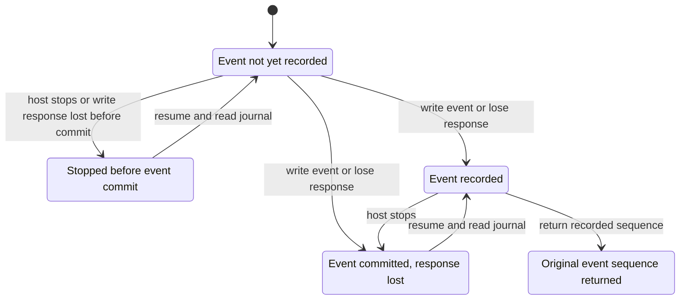
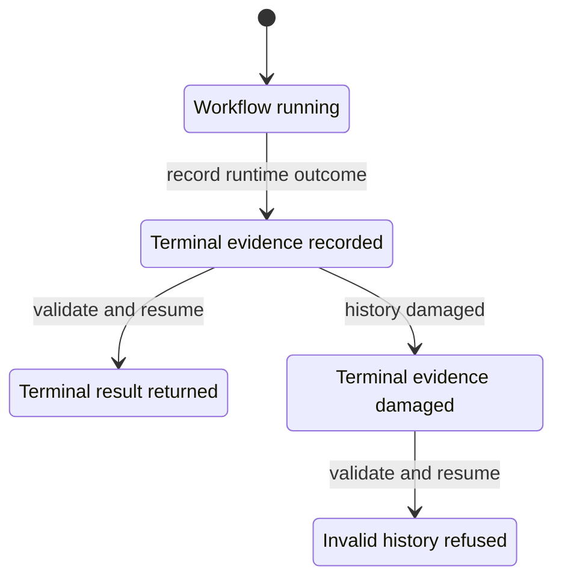
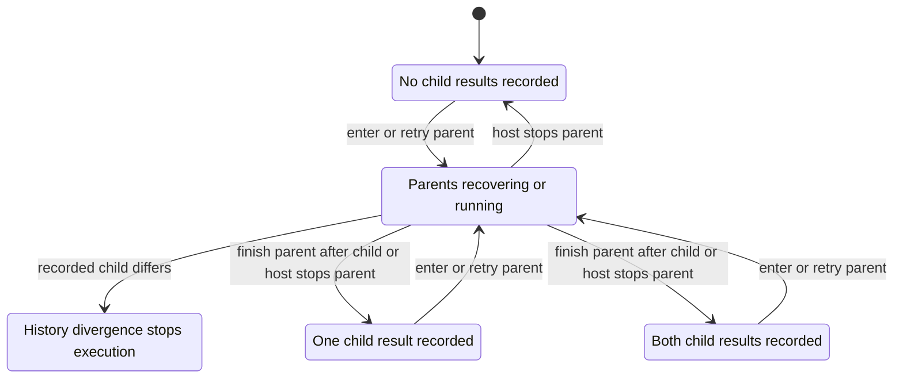
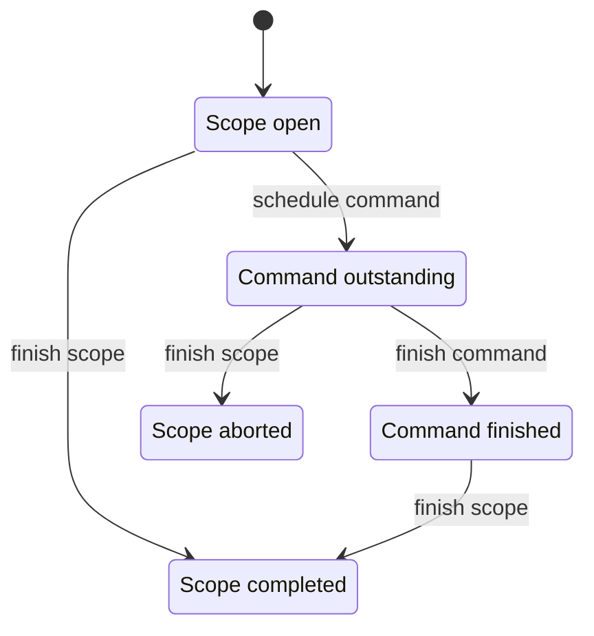
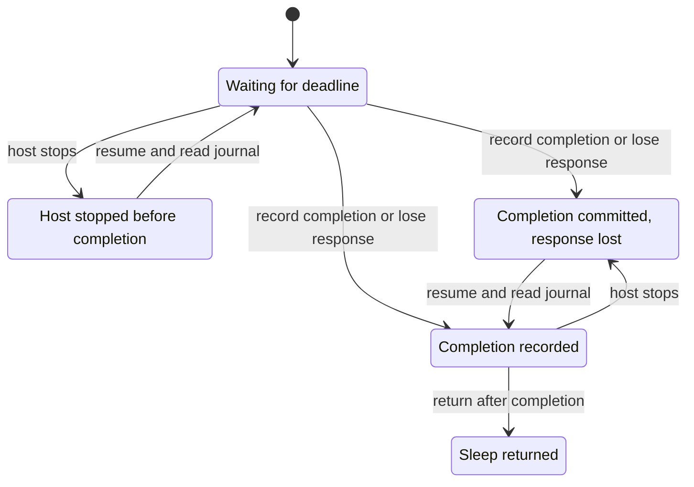
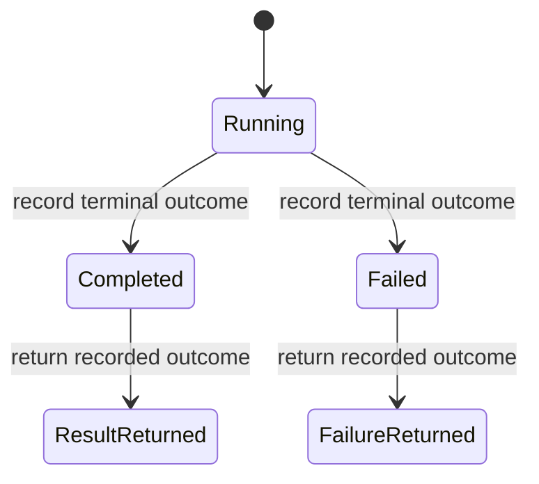
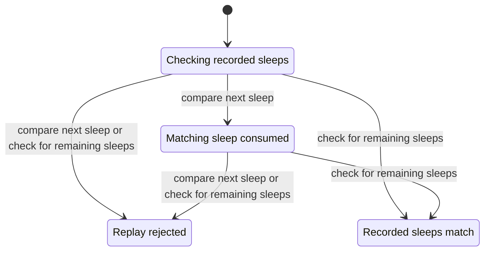
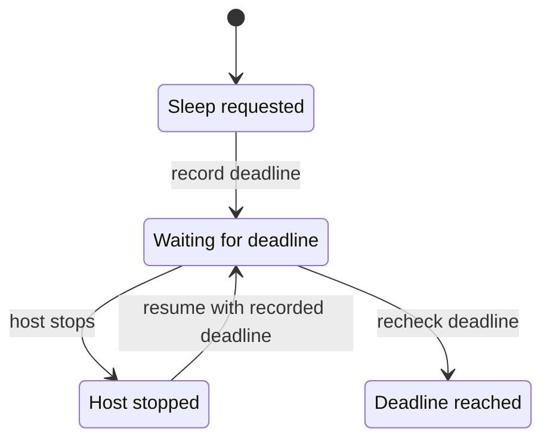

# @hobo/runtime

The **SDK runtime-primitives package**: app-facing authoring surfaces and the
deterministic-replay library that backs them.

- **Trainable methods (ADR-0025 / ADR-0125)** — `training(fn, opts)`,
  signature-only `training.define()` empty implementations served by a
  contract-derived stub (`defineGrounding()` is the same function under the
  name the registrations call that `hobo stub` generates for an ambient
  `@trainable declare class`, in `src/_generated/declared/<Class>.ts`;
  ADR-0128), the optional `@trainable` class decorator and `@intent` method
  decorator (including projects using `exactOptionalPropertyTypes`),
  the `"use training"` grounding lint, and `applyTrainingArtifact()` for
  apply-at-load promotion. See `src/training/`. The JSON types this surface
  is typed in (`JsonValue`, `JsonObject`, `JsonBag`) are exported from the
  root too, so a generated module whose exports infer `Trainable<JsonValue,
  JsonValue>` compiles with `declaration: true`.
- **Deterministic replay** (`./replay` export) — the replay/divergence/
  equivalence engine (ADR-0086), promoted from the
  `deterministic-replay-engine` draft proof (frozen in
  `scripts/promotions.json`).

## Naming: `runtime` vs `runtimes/`

These are different concerns that share a word:

- **`packages/runtime` (`@hobo/runtime`, this package)** — the *SDK
  primitives* layer app code imports (`import { training } from
  "@hobo/runtime"`); no I/O, no substrate.
- **`packages/runtimes/*` (e.g. `@hobo/runtime-local`)** — concrete *runtime
  backends* implementing the durable runtime ports (EventStore, Queue,
  Clock, component host) for a substrate. `runtime-local/src/replay.ts` is
  that backend's record/replay **link mode** (ADR-0076), not this package's
  replay engine.

The glossary's "Runtime" entry records the same disambiguation.

`WorkflowFailure` preserves an omitted step or cause as `undefined` rather than
manufacturing placeholder values.

## Durable messaging component hosts

`@hobo/runtime/durable-messaging-host` adapts one host-authorized
`DurableMessaging` port to the generated `hobo:durable-messaging` JavaScript
interface. The caller binds the port to the authenticated tenant and durable
instance; names and operation IDs supplied by a guest are not authorization.
A mandatory host authority checks current access before dispatch and again before
disclosing a response; the host must fence that authorization throughout each
call, including in-flight work that outlives a timeout. Instance-scoped
authorization is required for unfiltered audit events. The host issues a
separate instance-metadata grant for asynchronous `limits()` disclosure only
after authorizing the binding. Revocation is permanent for that grant; each
regrant requires a fresh grant and binding, and the host must propagate revocation
and fence in-flight work across processes. For `ensureSubscription`, the authorizer must authorize the supplied dead-letter
destination write as well as the source group. For `consume` and `nack`, the
authorizer must independently resolve the current subscription and authorize
its dead-letter destination write, including expiry-driven transfer;
source group permission alone is insufficient. Authorization is method-specific:
topic-wide `publish` and `compact` grants cover every subject and message and
all subscriptions affected by those operations. The callback does not receive
message subjects, bodies or attributes and cannot enforce content-level policy.
The adapter bounds and
detaches each request and response, converts WIT `u64`
values only when they fit a JavaScript safe integer, and checks receipt and
lease scope. An invalid operation envelope traps before dispatch. Once a valid
envelope is captured, malformed mutation data returns `unknown` for that exact
operation because an earlier attempt may have committed. Invalid audit reads
return `invalid-argument`. A lost reply, timeout, thrown provider call or
contradictory mutation response likewise returns `unknown`; none is treated as a
definite rejection.

`createDurableTopicPolicy` provides a provider-independent allow list for
application topic access. Each grant names a topic, whether publishing is
allowed, and the exact consumer groups and dead-letter destinations allowed
for subscriptions. It denies topic creation, compaction and unfiltered audit
reads. Its `verify` callback receives the current request and the captured
grant on dispatch and disclosure; the host must authenticate the principal and
independently verify the current subscription and dead-letter authority. The
policy snapshots its bounded grants and `revoke()` permanently denies access.
Use its `authorize` function as the host authorizer; revoke the limits grant and
fence in-flight work separately. A denied mutation returns `unknown` for its
operation ID because an earlier attempt could have committed.

`compileBindleTopicGrants` derives those grants from a Bindle application's
topic dependency edges and each topic's declared `publish` and `subscribe`
permissions. Supply one explicit runtime topic binding for every topic edge,
including the consumer groups and dead-letter destinations for subscriptions.
It rejects missing or extra bindings, duplicate runtime topic names and
unconfigured subscriptions. It returns each source resource name alongside its
grant so the host can attest the exact source-to-provider mapping. It does not
provision topics, authenticate the Bindle or verify the provider's state.


```ts
import { bindle } from "@hobo/bindles";
import {
  compileBindleTopicGrants,
  createDurableMessagingWitImports,
  createDurableTopicPolicy,
} from "@hobo/runtime/durable-messaging-host";

const shop = bindle("shop", (b) => {
  const orders = b.topic().allow("publish", "subscribe");
  return { orders, web: b.web().dependsOn(orders) };
});
const bindings = compileBindleTopicGrants({
  applicationName: "web",
  resources: shop.resources,
  edges: shop.edges,
  bindings: [{
    resourceName: "orders",
    topic: "orders",
    subscriptions: [{ consumerGroup: "fulfillment", deadLetterTopic: "orders-dlq" }],
  }],
});
const topicPolicy = createDurableTopicPolicy({
  grants: bindings.map((binding) => binding.grant),
  verify: (claim) => host.verifyTopicBindingAndCurrentSubscription(bindings, claim),
});

const imports = createDurableMessagingWitImports(authorizedMessagingPort, {
  lifecycle,
  limitsGrant,
  authorize: topicPolicy.authorize,
});
```

`createBindleTopicWitHost` connects that mapping to the asynchronous WIT host
for any `DurableMessaging` port. Its verifier receives the exact port, Bindle and
application names, resource binding, request and, for subscriptions, the configured group and
dead-letter destination. The trusted host must independently authenticate the
application, mapping, port and current provider state; a callback that simply
returns true does not establish those facts. Revoking the returned host policy
does not cancel an in-flight provider operation or revoke other processes.
The returned immutable `bindings` identify the runtime topic for each declared
resource, so a host can supply the mapping to the authenticated application.

```ts
import { createBindleTopicWitHost } from "@hobo/runtime/durable-messaging-host";

const topicHost = createBindleTopicWitHost(authorizedMessagingPort, {
  bindleName: shop.name,
  applicationName: "web",
  resources: shop.resources,
  edges: shop.edges,
  bindings: [{
    resourceName: "orders",
    topic: "orders",
    subscriptions: [{ consumerGroup: "fulfillment", deadLetterTopic: "orders-dlq" }],
  }],
}, {
  lifecycle,
  limitsGrant,
  verify: (claim) => host.verifyTopicBindingAndCurrentSubscription(claim),
});
// Expose topicHost.host to the authenticated asynchronous component instance.
// Call topicHost.revoke() when its authority is revoked.
```

For JavaScript application logic, the authenticated host can pass
`topicHost.topic("orders")` as the application's topic capability. The client
uses the declared runtime topic and configured dead-letter destination; the
application supplies a permitted consumer group and cannot substitute either.
Its asynchronous inputs and outcomes use the WIT types, including `bigint`
operation expiries. Create a distinct operation for each logical mutation and
reuse it only when retrying that mutation.

```ts
import { durableMessagingOperation } from "@hobo/core";

const orders = topicHost.topic("orders");
const operation = durableMessagingOperation(host.expiryMs, host.randomNonce);
const result = await orders.publish({
  operation: { id: operation.id, expiresAtMs: BigInt(operation.expiresAtMs) },
  message: { id: "order-1", subject: "created", payload: new Uint8Array([1]), attributes: [] },
});
// result.tag is committed, rejected, unknown or expired.
```

```ts
import {
  createDurableMessagingLifecycle,
  createDurableMessagingLimitsGrant,
  createDurableMessagingWitImports,
} from "@hobo/runtime/durable-messaging-host";

// Create these only after the host authenticates and authorizes the instance.
const lifecycle = createDurableMessagingLifecycle({ maxInFlight: 128 });
const limitsGrant = createDurableMessagingLimitsGrant();
const imports = createDurableMessagingWitImports(authorizedMessagingPort, {
  lifecycle,
  limitsGrant,
  authorize: (request) => host.verifyMessagingAccess(binding, request),
  timeoutMs: 30_000,
});
// On revocation, call limitsGrant.revoke() and revoke the host authority.
// A JS component host supplies `imports` for the authenticated binding.
```

Ports with an accessor-backed `limits` field are rejected by default without
running the accessor. A trusted embedding host can instead create a
`createDurableMessagingPortMetadataGrant` for one exact port and a detached
limits snapshot, with a synchronous verifier that independently authenticates
the port, the entire snapshot and the current metadata authority. Pass that
grant as `portMetadataGrant` when constructing the WIT host. The verifier is
checked before metadata disclosure, before dispatch, and after provider work
and disclosure authorization. Revoking the grant permanently closes that
binding; a false or throwing verifier fails closed. Revocation must also be
propagated to the provider's own metadata capability and other processes.
The verifier is trusted host code, not proof of its own source, and cannot
replace a held cross-process ownership fence, bounded stream disclosure or an
independent watchdog for blocked synchronous callbacks.
A synchronous metadata verifier must not return a promise. An ordinary native
promise is observed and refused; exotic or proxied promises are refused without
reading their thenables or constructors. The caller remains responsible for
handling any rejection from an exotic promise.

The host must isolate the JavaScript realm and its globals before loading the
bridge and throughout its lifetime; the bridge captures selected intrinsics,
but does not make an adversarial shared realm safe.

Timeouts do not cancel provider work. An in-flight slot remains occupied until
that work actually settles, even if the guest has already received `unknown`.
Retry only the same operation against the same independently authenticated
journal. After receipt expiry, fencing and draining previous attempts alone
cannot establish noncommit: a separately authenticated noncommit proof is also
needed before replacing the operation. Audit gaps or absent events do not prove
failure. Hosts must enforce the port's durable receipts, authorization and clock
requirements; validating the shape of a response cannot prove durability.
A consume receipt may replay an already expired or superseded lease. Before a
fenced handler effect, the host must independently verify current authorization
and lease ownership; the bridge checks their shape and scope only. The embedding
host must also bound component memory, call resources and serialized input
before JCO materializes JavaScript values. Share a single lifecycle across all
bindings for the authenticated instance in one process; `maxInFlight` applies
to that lifecycle and is not a fleet-wide quota. A trusted durable host authority
must enforce the corresponding cross-process fence and prevent a new lifecycle
from bypassing unresolved work. Creating a new in-memory lifecycle does not prove
old starts, calls, or executor credentials were fenced. Before replacement the
host must independently fence and drain old executors and reconcile unresolved
work, using authenticated noncommit evidence where noncommit is asserted.

For JCO components, `instantiateDurableMessagingAsync` links the native
`hobo:durable-messaging/messaging@0.1.0` asynchronous ABI using JSPI
suspension. It refuses a runtime lacking `WebAssembly.Suspending` and
`WebAssembly.promising`; Node 24 requires `--experimental-wasm-stack-switching`.
The trusted verifier must independently bind the component digest, its complete
import list, the supplied factory, its core Wasm modules and the exact branded
host binding, including its principal, instance and grant epoch. The host must
keep those artifacts and the binding immutable. Verification is a trusted,
bounded, nonblocking synchronous callback; the start timeout cannot interrupt it and begins after verification.
The adapter checks that the exact versioned interface is
present before passing JCO's short alias solely to that verified factory.
Configure JCO's JSPI transpiler to mark all nine imports and each
guest entry point that can call them as asynchronous. For example, a host that
has already identified the component and its factory can pass its independent
verification capability:

```ts
import {
  createDurableMessagingWitHost,
  instantiateDurableMessagingAsync,
} from "@hobo/runtime/durable-messaging-host";

// Reuse the instance lifecycle and limits grant from the authorized binding.
const messaging = createDurableMessagingWitHost(authorizedMessagingPort, {
  lifecycle,
  limitsGrant,
  authorize: (request) => host.verifyMessagingAccess(binding, request),
});
const start = await instantiateDurableMessagingAsync(messaging, {
  component: hostComponent,
  verify: (candidate, bindingHost) => host.verifyComponentAndBinding(candidate, bindingHost),
  timeoutMs: 30_000,
});
if (start.status === "started") {
  const app = start.value;
  // The host may invoke the verified component here.
} else if (start.status === "busy") {
  // This attempt did not start; the shared lifecycle is already in use.
} else {
  // Start effects are unknown; fence and reconcile before replacement.
}
```

A timed-out or failed start, or a factory that finishes while an import remains
active, returns `unknown` and permanently fences all bindings sharing that local
lifecycle. In-flight operations remain counted until they settle; late
verification cannot dispatch after the start deadline. The host must maintain an
independently authenticated complete record of start-time operation identities
and attempts, including those still in flight, or reconcile the whole fenced
instance and journal before replacement. `started` only means the factory
returned and no import remains active: it does not reconcile an import that
already returned `unknown`. The guest and host must retain and reconcile such
operations even when the factory ignores that result. A same-thread timer cannot
interrupt synchronous JavaScript or Wasm that never yields. Run untrusted
components under an independently enforceable worker or process watchdog with
CPU and memory limits; after termination, fence the executor and reconcile any
prior effects. The monotonic deadline detects an eventual late return but cannot
produce a result while the event loop is blocked.

This JCO/JSPI path executes native async WIT components. The existing Wasmtime
subprocess and JSON-only local component host do not yet link this interface;
this adapter does not enable those hosts by itself.

## Durable workflows

Fresh workflows claim a new journal atomically before user steps execute. Generated IDs use random UUIDs; a host that needs the ID to recover after a crash can pass `{ runId }` to `start` and persist that ID first. A duplicate ID is rejected, assuming the event store enforces its expected-sequence compare-and-set.

An explicit run ID must be a nonempty primitive string for start, resume and
journal access. Omitting it on start generates an ID; passing null, a number,
an empty string or an object is rejected rather than coercing it into a stream
name. Rejection does not invoke conversion hooks on an object ID.

Workflow input must be an ordinary JSON tree. The engine captures it before
the first asynchronous operation, so later caller edits do not change the run.
Unsupported inputs, including `undefined`, non-finite numbers, dates, shared
references, proxies, accessors and frozen objects, are rejected before a new
journal is claimed. Convert them to explicit JSON before starting or resuming.
Older runs created from such inputs may need application-specific recovery.

Workflow and step results must be ordinary JSON trees or top-level `undefined`.
Dates, non-finite numbers, shared or circular references, accessors, proxies,
sparse arrays, frozen objects and other values that cannot be faithfully
replayed are refused. Results are captured before storage waits, so later edits
to the original do not change the first returned value. An unsupported result
raises a workflow failure; an unsupported step result also records a step
failure. A journaled `run.StepFailed` replays by rethrowing that failure without
re-running the step effect. Convert other values to explicit JSON. Values
already lost in older journals cannot be recovered.

The [workflow replay verification skill](../../.agents/skills/verify-workflow-replay/SKILL.md)
includes statecharts and bounded models for input and result capture. They
check 18 input states and 15 result states, including start and resume input
isolation (mutation checks on those capture sites), edits around journal
writes, and restarts. A 16-state model checks run-ID validation.

`resume` requires an existing `run.Started`, the original JSON-normalized input, and the recorded workflow name when available. Legacy journals without recorded input are interpreted as null input. It uses the recorded seed; old journals without a name cannot validate workflow identity, and those without a seed use the engine seed. Completed journaled steps are reused; a recorded `run.StepFailed` replays as failure without re-running the step. An external effect can still repeat if the host crashes after the effect and before recording its completion. Concurrent resumes require host-side fencing. See the [workflow replay verification skill](../../.agents/skills/verify-workflow-replay/SKILL.md).

A missing earlier step outcome is accepted only when that step was scheduled;
this permits recovery when parallel steps finish out of order. Replay validates
the recorded name before running the unfinished step and reuses later saved
outcomes. A workflow may catch a step failure, perform compensating steps, and
complete. Replay rethrows the saved failure into the workflow so it can take
the same path. The workflow cannot record either terminal state while a prior
outcome remains unconsumed. The bounded models check these paths and guards.

Within one execution, journal appends are serialized even when workflow steps
run concurrently. If an append fails or its result is uncertain, later appends
in that execution fail with the same error; use a fresh `resume` to reread the
durable journal. An effect already authorized before the failure may still be
running, and separate executions are not fenced by this queue. A journal at
`Number.MAX_SAFE_INTEGER` cannot accept another event until its sequence format
is migrated; invalid or exhausted sequences fail before the next step runs.

Resuming a completed or failed run returns its recorded terminal outcome without
calling the workflow or appending another event. A workflow that returns while
a step, sleep, or event it started is still outstanding is aborted with
`WorkflowExecutionAborted` before any terminal outcome is recorded, and the
orphaned command cannot append afterward. Live `appendEvent` also refuses
further `run.*` facts once a terminal is already in the in-memory journal. For
versioned journals, resume first validates the command tree and refuses missing
completion evidence, duplicate terminal outcomes, and records after the
terminal outcome. A journal
with multiple terminal facts is rejected before returning an outcome. Unknown
command-tree versions are refused. New failure records preserve the failed step
when present; older failure records without a step cannot reconstruct that
detail.

Application `ctx.emit` event types cannot begin with `run.`; those names belong
to the workflow engine. New journals include command identity in each emitted
event's metadata. Resume and parent retries reuse a committed event and return
its original sequence, including when the write response was lost. Changed
event type, payload, or order aborts the execution. The event store must
preserve this metadata and provide atomic expected-sequence writes. SQLite
normalizes a null event payload to `{}`; the metadata preserves the original
command value for recovery. Older journals do not identify emitted commands,
so an event can be repeated when they resume.

The journal and its writer are trusted: records written by older versions or by
another writer cannot be authenticated retroactively. Legacy unversioned
journals retain their previous resume checks.

The event-recovery model explores five distinct states. Its projection hides one
internal transition that does not change the displayed state.



The journal-authority model explores 10 distinct states. Its projection hides
five internal transitions that do not change the displayed state.



Replay checks each recorded sleep in order and refuses missing, changed, or
unused sleep records and unused completed steps. Existing sleep records without
an index are read in journal order; indexed records must also match their
position. Resume checks previously recorded step and sleep commands before
continuing, and a changed or shortened history aborts the execution even if
application code catches the error.

New journals record the parent of each step or sleep, including across
concurrent step bodies. Resume matches commands in order within each parent,
reuses completed nested steps and sleeps, and replays recorded step failures.
Retries of a parent reuse completed child commands. Replay can use a completed
parent when nested steps have outcomes and nested sleeps have completion facts;
it refuses children that were unfinished when the parent ended. Older journals
may lack parent information or sleep completion facts and retain the flat
resume path. Version-three histories also include `ctx.emit` commands in each
parent's ordered history.

Await `ctx.step`, `ctx.sleep`, and `ctx.emit` before returning from
their parent. If a parent finishes with one of these commands still pending,
the execution aborts without writing a terminal result and refuses further
queued journal writes. A callback that retains a closed asynchronous parent
scope cannot start another command. A storage write or external effect already
in progress may still finish, so the host must account for it before resuming.
These checks do not control arbitrary effects performed directly by workflow
code or callbacks invoked from an unrelated asynchronous context.

The nested-resume model explores 72 distinct states. Its projection hides 111
internal transitions that do not change the displayed state.



The command-lifetime model explores 14 distinct states. This projection hides
11 internal transitions that do not change the displayed state.



`ctx.sleep` records its deadline before waiting, rechecks the clock after
each wake-up, and records completion after the deadline. If a host stops, an
explicit `resume` uses that same deadline and reuses a completion that was
committed before a response was lost; time spent offline counts toward the delay.
New-format replay rejects missing, duplicate, or early completion evidence. A
running host uses Node timers by
default. Tests and other hosts can supply `clock` and `wait` to the workflow
engine; the clock must report accurate nonnegative integer milliseconds and
the waiter must eventually return. The host must arrange recovery and call
`resume`: this engine does not automatically discover or wake stopped runs.
Concurrent resumes still require host-side fencing.

The sleep-completion model explores 12 distinct states. Its projection hides nine
clock and other transitions that do not change the displayed state.



An unfinished older sleep record has no deadline. On its first resume the
engine records a new deadline for the full original delay, then preserves it
across later restarts. Older runs that already continued past an immediate
sleep cannot have their elapsed-time behavior corrected retroactively.

The terminal-outcome model explores 15 distinct states and 18 transitions.
The verification runner also checks that a resume which writes a second
terminal fact violates the model's invariant.
This projection hides ten transitions that do not change the displayed state;
it shows the modeled flow, rather than a trace of one execution.



The timer replay model explores 120 distinct states. This projection hides 53
transitions that do not change the displayed state.



The sleep-deadline model explores 22 distinct states. The projection hides 20
clock or wake-up transitions that do not change the displayed state.



### Durable topic provisioning

The asynchronous messaging host provisions each declared topic and its
dead-letter journals through a provider-neutral administrative port. It checks
the full bounded request before dispatch and returns completed, uncertain and
unattempted work explicitly. Callers must persist operation identities and
reuse them when reconciling uncertain outcomes. The finite provisioning model
assumes that the selected provider honors idempotent replay.
Its retry transition abstracts replay of previously confirmed operations before
the operation whose outcome is unknown.

A scoped topic host is exposed only after all of its declared journals are
confirmed. Rejected or uncertain provisioning leaves the host unavailable.
`prepareBindleTopicWitHost` performs that preparation using the caller's
persisted operation identities. The host and provisioner use the same validated
binding snapshot if caller-owned input changes during preparation.

`createBindleTopicPreparation` shares concurrent and synchronously reentrant
preparation attempts. Retries reuse the captured operation identities, which the
caller must persist across restarts.

The durable messaging boundary captures its array mapping intrinsic before
processing Bindle graphs and provider results. Later changes to
`Array.prototype.map` cannot change the grants or mapped message data.

`createDurableQueueWitHost` in `@hobo/runtime/durable-queue-host` exposes the
asynchronous queue component interface around a `DurableQueue` provider. It
checks and copies component requests and provider responses, authorizes dispatch
and disclosure, and reports an uncertain outcome when a call times out, access
is denied, or a response cannot be trusted. Work that outlives a timeout keeps
its per-host capacity slot until it settles; a repeated in-flight operation is
not dispatched again by that host. Deadline observation and the in-flight guard
use captured intrinsics; result variants have no inherited `then` property. The
provider must durably bind operation IDs to exact requests, fence leases, and
supply idempotent replay across hosts and
restarts. The host creator must authenticate and scope the queue binding, attest
the limits, supply a trusted clock and authorization callback, and bound the
number of host instances. A synchronous blocked callback cannot be interrupted
by the deadline. The bounded queue model describes a single-dispatch abstraction;
it does not prove this host or the provider's replay and durability assumptions.
The host does not itself implement or map a cloud queue.

The internal atomic queue transition function records bounded operation receipts,
message idempotency using canonical request fingerprints, lease generations,
and explicit capacity, identifier exhaustion, and delivery exhaustion outcomes. Completed and exhausted messages remain retained; there is
no compaction or dead-letter operation yet, so a finite queue eventually requires
operator reconciliation. The transition requires validated inputs, a monotonic
trusted clock, and an atomic durable state owner. The provider below supplies
the storage connection.

`createAtomicDurableQueue` from `@hobo/runtime/atomic-durable-queue` connects the
transition function to an injected atomic store. The store must provide durable,
linearizable reads and compare-and-swap over one exclusively owned, epoch-fenced
record. The provider reconstructs state from a versioned log, checks its revision
and declared limits, and returns unknown on an ambiguous write. All writers must
use the same monotonic clock. The log retains at most 512 state-changing operations
and 256 KiB for the lifetime of the record; it has no compaction, and returns
unknown when full. Completed or exhausted messages remain retained. The storage
owner and trusted deployment must fence old writers and preserve the record
across restarts; deleting it destroys receipts and idempotency history. The log
version must change when replay semantics change.

The internal queue checkpoint codec preserves messages, sequence counters and
unexpired operation receipts, and checks limits, identities, lease references
and delivery content when it reads a checkpoint. It assumes that the storage
record is controlled by an authorized writer; structural checks cannot prove the
history in an externally forged checkpoint. The codec is not yet connected to a
compaction operation.
