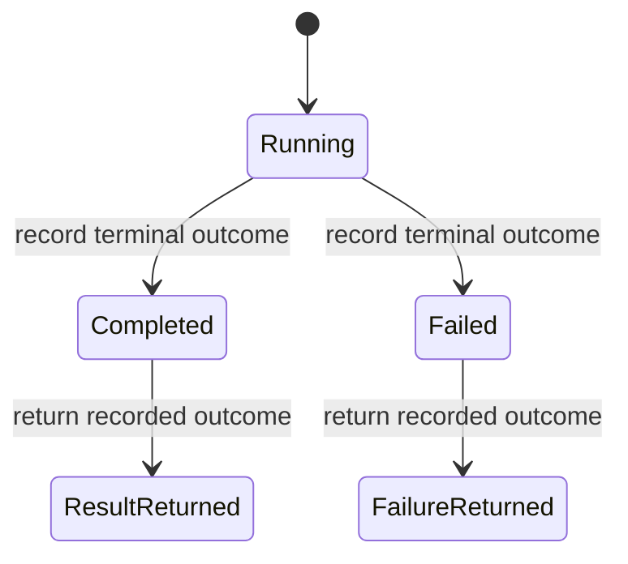

# @hobo/runtime

The **SDK runtime-primitives package**: app-facing authoring surfaces and the
deterministic-replay library that backs them.

- **Trainable methods (ADR-0025 / ADR-0125)** — `training(fn, opts)`,
  signature-only `training.define()` empty implementations served by a
  contract-derived stub (`defineGrounding()` is the same function under the
  name the registrations call that `hobo stub` generates for an ambient
  `@trainable declare class`, in `src/_generated/declared/<Class>.ts`;
  ADR-0128), the optional `@trainable` class decorator and `@intent` method
  decorator (including projects using `exactOptionalPropertyTypes`),
  the `"use training"` grounding lint, and `applyTrainingArtifact()` for
  apply-at-load promotion. See `src/training/`. The JSON types this surface
  is typed in (`JsonValue`, `JsonObject`, `JsonBag`) are exported from the
  root too, so a generated module whose exports infer `Trainable<JsonValue,
  JsonValue>` compiles with `declaration: true`.
- **Deterministic replay** (`./replay` export) — the replay/divergence/
  equivalence engine (ADR-0086), promoted from the
  `deterministic-replay-engine` draft proof (frozen in
  `scripts/promotions.json`).

## Naming: `runtime` vs `runtimes/`

These are different concerns that share a word:

- **`packages/runtime` (`@hobo/runtime`, this package)** — the *SDK
  primitives* layer app code imports (`import { training } from
  "@hobo/runtime"`); no I/O, no substrate.
- **`packages/runtimes/*` (e.g. `@hobo/runtime-local`)** — concrete *runtime
  backends* implementing the durable runtime ports (EventStore, Queue,
  Clock, component host) for a substrate. `runtime-local/src/replay.ts` is
  that backend's record/replay **link mode** (ADR-0076), not this package's
  replay engine.

The glossary's "Runtime" entry records the same disambiguation.

`WorkflowFailure` preserves an omitted step or cause as `undefined` rather than
manufacturing placeholder values.

## Durable messaging component hosts

`@hobo/runtime/durable-messaging-host` adapts one host-authorized
`DurableMessaging` port to the generated `hobo:durable-messaging` JavaScript
interface. The caller binds the port to the authenticated tenant and durable
instance; names and operation IDs supplied by a guest are not authorization.
A mandatory host authority checks current access before dispatch and again before
disclosing a response; the host must fence that authorization throughout each
call, including in-flight work that outlives a timeout. Instance-scoped
authorization is required for unfiltered audit events. The host issues a
separate instance-metadata grant for asynchronous `limits()` disclosure only
after authorizing the binding. Revocation is permanent for that grant; each
regrant requires a fresh grant and binding, and the host must propagate revocation
and fence in-flight work across processes. For `ensureSubscription`, the authorizer must authorize the supplied dead-letter
destination write as well as the source group. For `consume` and `nack`, the
authorizer must independently resolve the current subscription and authorize
its dead-letter destination write, including expiry-driven transfer;
source group permission alone is insufficient. Authorization is method-specific:
topic-wide `publish` and `compact` grants cover every subject and message and
all subscriptions affected by those operations. The callback does not receive
message subjects, bodies or attributes and cannot enforce content-level policy.
The adapter bounds and
detaches each request and response, converts WIT `u64`
values only when they fit a JavaScript safe integer, and checks receipt and
lease scope. An invalid operation envelope traps before dispatch. Once a valid
envelope is captured, malformed mutation data returns `unknown` for that exact
operation because an earlier attempt may have committed. Invalid audit reads
return `invalid-argument`. A lost reply, timeout, thrown provider call or
contradictory mutation response likewise returns `unknown`; none is treated as a
definite rejection.

```ts
import {
  createDurableMessagingLifecycle,
  createDurableMessagingLimitsGrant,
  createDurableMessagingWitImports,
} from "@hobo/runtime/durable-messaging-host";

// Create these only after the host authenticates and authorizes the instance.
const lifecycle = createDurableMessagingLifecycle({ maxInFlight: 128 });
const limitsGrant = createDurableMessagingLimitsGrant();
const imports = createDurableMessagingWitImports(authorizedMessagingPort, {
  lifecycle,
  limitsGrant,
  authorize: (request) => host.verifyMessagingAccess(binding, request),
  timeoutMs: 30_000,
});
// On revocation, call limitsGrant.revoke() and revoke the host authority.
// A JS component host supplies `imports` for the authenticated binding.
```

Ports with an accessor-backed `limits` field are rejected by default without
running the accessor. A trusted embedding host can instead create a
`createDurableMessagingPortMetadataGrant` for one exact port and a detached
limits snapshot, with a synchronous verifier that independently authenticates
the port, the entire snapshot and the current metadata authority. Pass that
grant as `portMetadataGrant` when constructing the WIT host. The verifier is
checked before metadata disclosure, before dispatch, and after provider work
and disclosure authorization. Revoking the grant permanently closes that
binding; a false or throwing verifier fails closed. Revocation must also be
propagated to the provider's own metadata capability and other processes.
The verifier is trusted host code, not proof of its own source, and cannot
replace a held cross-process ownership fence, bounded stream disclosure or an
independent watchdog for blocked synchronous callbacks.
A synchronous metadata verifier must not return a promise. An ordinary native
promise is observed and refused; exotic or proxied promises are refused without
reading their thenables or constructors. The caller remains responsible for
handling any rejection from an exotic promise.

The host must isolate the JavaScript realm and its globals before loading the
bridge and throughout its lifetime; the bridge captures selected intrinsics,
but does not make an adversarial shared realm safe.

Timeouts do not cancel provider work. An in-flight slot remains occupied until
that work actually settles, even if the guest has already received `unknown`.
Retry only the same operation against the same independently authenticated
journal. After receipt expiry, fencing and draining previous attempts alone
cannot establish noncommit: a separately authenticated noncommit proof is also
needed before replacing the operation. Audit gaps or absent events do not prove
failure. Hosts must enforce the port's durable receipts, authorization and clock
requirements; validating the shape of a response cannot prove durability.
A consume receipt may replay an already expired or superseded lease. Before a
fenced handler effect, the host must independently verify current authorization
and lease ownership; the bridge checks their shape and scope only. The embedding
host must also bound component memory, call resources and serialized input
before JCO materializes JavaScript values. Share a single lifecycle across all
bindings for the authenticated instance in one process; `maxInFlight` applies
to that lifecycle and is not a fleet-wide quota. A trusted durable host authority
must enforce the corresponding cross-process fence and prevent a new lifecycle
from bypassing unresolved work. Creating a new in-memory lifecycle does not prove
old starts, calls, or executor credentials were fenced. Before replacement the
host must independently fence and drain old executors and reconcile unresolved
work, using authenticated noncommit evidence where noncommit is asserted.

For JCO components, `instantiateDurableMessagingAsync` links the native
`hobo:durable-messaging/messaging@0.1.0` asynchronous ABI using JSPI
suspension. It refuses a runtime lacking `WebAssembly.Suspending` and
`WebAssembly.promising`; Node 24 requires `--experimental-wasm-stack-switching`.
The trusted verifier must independently bind the component digest, its complete
import list, the supplied factory, its core Wasm modules and the exact branded
host binding, including its principal, instance and grant epoch. The host must
keep those artifacts and the binding immutable. Verification is a trusted,
bounded, nonblocking synchronous callback; the start timeout cannot interrupt it and begins after verification.
The adapter checks that the exact versioned interface is
present before passing JCO's short alias solely to that verified factory.
Configure JCO's JSPI transpiler to mark all nine imports and each
guest entry point that can call them as asynchronous. For example, a host that
has already identified the component and its factory can pass its independent
verification capability:

```ts
import {
  createDurableMessagingWitHost,
  instantiateDurableMessagingAsync,
} from "@hobo/runtime/durable-messaging-host";

// Reuse the instance lifecycle and limits grant from the authorized binding.
const messaging = createDurableMessagingWitHost(authorizedMessagingPort, {
  lifecycle,
  limitsGrant,
  authorize: (request) => host.verifyMessagingAccess(binding, request),
});
const start = await instantiateDurableMessagingAsync(messaging, {
  component: hostComponent,
  verify: (candidate, bindingHost) => host.verifyComponentAndBinding(candidate, bindingHost),
  timeoutMs: 30_000,
});
if (start.status === "started") {
  const app = start.value;
  // The host may invoke the verified component here.
} else if (start.status === "busy") {
  // This attempt did not start; the shared lifecycle is already in use.
} else {
  // Start effects are unknown; fence and reconcile before replacement.
}
```

A timed-out or failed start, or a factory that finishes while an import remains
active, returns `unknown` and permanently fences all bindings sharing that local
lifecycle. In-flight operations remain counted until they settle; late
verification cannot dispatch after the start deadline. The host must maintain an
independently authenticated complete record of start-time operation identities
and attempts, including those still in flight, or reconcile the whole fenced
instance and journal before replacement. `started` only means the factory
returned and no import remains active: it does not reconcile an import that
already returned `unknown`. The guest and host must retain and reconcile such
operations even when the factory ignores that result. A same-thread timer cannot
interrupt synchronous JavaScript or Wasm that never yields. Run untrusted
components under an independently enforceable worker or process watchdog with
CPU and memory limits; after termination, fence the executor and reconcile any
prior effects. The monotonic deadline detects an eventual late return but cannot
produce a result while the event loop is blocked.

This JCO/JSPI path executes native async WIT components. The existing Wasmtime
subprocess and JSON-only local component host do not yet link this interface;
this adapter does not enable those hosts by itself.

## Durable workflows

Fresh workflows claim a new journal atomically before user steps execute. Generated IDs use random UUIDs; a host that needs the ID to recover after a crash can pass `{ runId }` to `start` and persist that ID first. A duplicate ID is rejected, assuming the event store enforces its expected-sequence compare-and-set.

An explicit run ID must be a nonempty primitive string for start, resume and
journal access. Omitting it on start generates an ID; passing null, a number,
an empty string or an object is rejected rather than coercing it into a stream
name. Rejection does not invoke conversion hooks on an object ID.

Workflow input must be an ordinary JSON tree. The engine captures it before
the first asynchronous operation, so later caller edits do not change the run.
Unsupported inputs, including `undefined`, non-finite numbers, dates, shared
references, proxies, accessors and frozen objects, are rejected before a new
journal is claimed. Convert them to explicit JSON before starting or resuming.
Older runs created from such inputs may need application-specific recovery.

Workflow and step results must be ordinary JSON trees or top-level `undefined`.
Dates, non-finite numbers, shared or circular references, accessors, proxies,
sparse arrays, frozen objects and other values that cannot be faithfully
replayed are refused. Results are captured before storage waits, so later edits
to the original do not change the first returned value. An unsupported result
raises a workflow failure; an unsupported step result also records a step
failure. A journaled `run.StepFailed` replays by rethrowing that failure without
re-running the step effect. Convert other values to explicit JSON. Values
already lost in older journals cannot be recovered.

The [workflow replay verification skill](../../.agents/skills/verify-workflow-replay/SKILL.md)
includes statecharts and bounded models for input and result capture. They
check 18 input states and 15 result states, including start and resume input
isolation (mutation checks on those capture sites), edits around journal
writes, and restarts. A 16-state model checks run-ID validation.

`resume` requires an existing `run.Started`, the original JSON-normalized input, and the recorded workflow name when available. Legacy journals without recorded input are interpreted as null input. It uses the recorded seed; old journals without a name cannot validate workflow identity, and those without a seed use the engine seed. Completed journaled steps are reused; a recorded `run.StepFailed` replays as failure without re-running the step. An external effect can still repeat if the host crashes after the effect and before recording its completion. Concurrent resumes require host-side fencing. See the [workflow replay verification skill](../../.agents/skills/verify-workflow-replay/SKILL.md).

A missing earlier step outcome is accepted only when that step was scheduled;
this permits recovery when parallel steps finish out of order. Replay validates
the recorded name before running the unfinished step and reuses later saved
outcomes. A workflow may catch a step failure, perform compensating steps, and
complete. Replay rethrows the saved failure into the workflow so it can take
the same path. The workflow cannot record either terminal state while a prior
outcome remains unconsumed. The bounded models check these paths and guards.

Resuming a completed or failed run returns its recorded terminal outcome without
calling the workflow or appending another event. Live `appendEvent` refuses
further `run.*` facts once a terminal is already in the in-memory journal, so
an unawaited step cannot corrupt a sealed run. A journal with multiple
terminal facts is rejected before returning an outcome. New failure records preserve
the failed step when present; older failure records without a step cannot
reconstruct that detail.

The terminal-outcome model explores 15 distinct states and 18 transitions.
The verification runner also checks that a resume which writes a second
terminal fact violates the model's invariant.
This projection hides ten transitions that do not change the displayed state;
it shows the modeled flow, rather than a trace of one execution.


