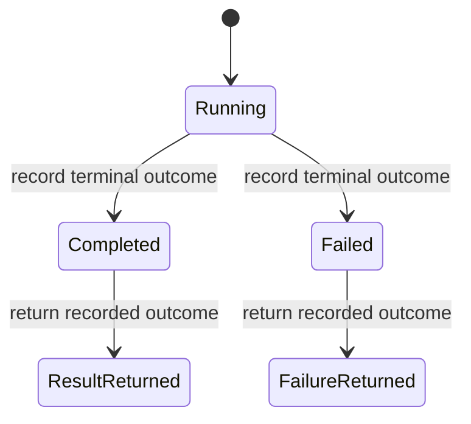
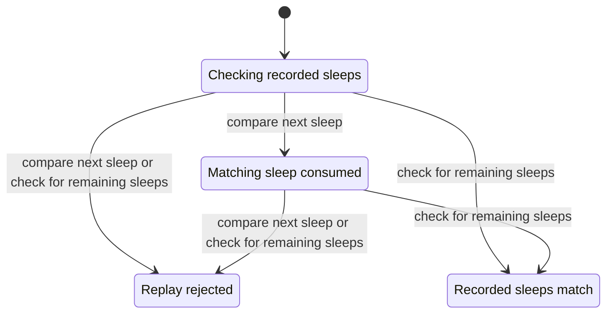
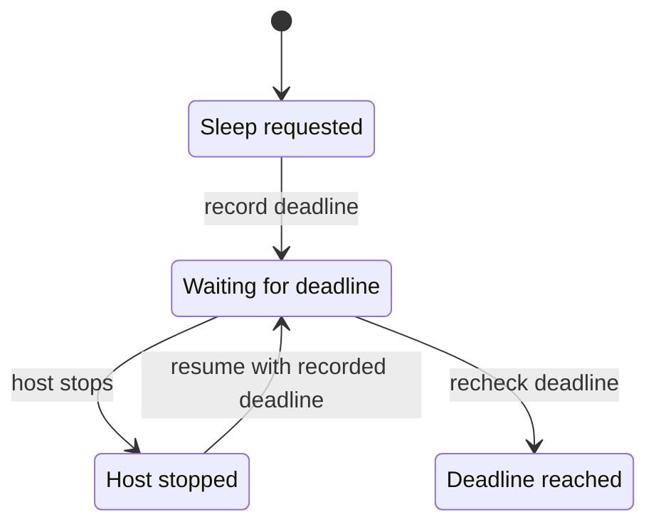

# @hobo/runtime

The **SDK runtime-primitives package**: app-facing authoring surfaces and the
deterministic-replay library that backs them.

- **Trainable methods (ADR-0025 / ADR-0125)** — `training(fn, opts)`,
  signature-only `training.define()` empty implementations served by a
  contract-derived stub (`defineGrounding()` is the same function under the
  name the registrations call that `hobo stub` generates for an ambient
  `@trainable declare class`, in `src/_generated/declared/<Class>.ts`;
  ADR-0128), the optional `@trainable` class decorator and `@intent` method
  decorator (including projects using `exactOptionalPropertyTypes`),
  the `"use training"` grounding lint, and `applyTrainingArtifact()` for
  apply-at-load promotion. See `src/training/`. The JSON types this surface
  is typed in (`JsonValue`, `JsonObject`, `JsonBag`) are exported from the
  root too, so a generated module whose exports infer `Trainable<JsonValue,
  JsonValue>` compiles with `declaration: true`.
- **Deterministic replay** (`./replay` export) — the replay/divergence/
  equivalence engine (ADR-0086), promoted from the
  `deterministic-replay-engine` draft proof (frozen in
  `scripts/promotions.json`).

## Naming: `runtime` vs `runtimes/`

These are different concerns that share a word:

- **`packages/runtime` (`@hobo/runtime`, this package)** — the *SDK
  primitives* layer app code imports (`import { training } from
  "@hobo/runtime"`); no I/O, no substrate.
- **`packages/runtimes/*` (e.g. `@hobo/runtime-local`)** — concrete *runtime
  backends* implementing the durable runtime ports (EventStore, Queue,
  Clock, component host) for a substrate. `runtime-local/src/replay.ts` is
  that backend's record/replay **link mode** (ADR-0076), not this package's
  replay engine.

The glossary's "Runtime" entry records the same disambiguation.

`WorkflowFailure` preserves an omitted step or cause as `undefined` rather than
manufacturing placeholder values.

## Durable workflows

Fresh workflows claim a new journal atomically before user steps execute. Generated IDs use random UUIDs; a host that needs the ID to recover after a crash can pass `{ runId }` to `start` and persist that ID first. A duplicate ID is rejected, assuming the event store enforces its expected-sequence compare-and-set.

`resume` requires an existing `run.Started`, the original JSON-normalized input, and the recorded workflow name when available. It uses the recorded seed; old journals without a name cannot validate workflow identity, and those without a seed use the engine seed. Completed journaled steps are reused, but an external effect can repeat if the host crashes after the effect and before recording its completion. Concurrent resumes require host-side fencing. See the [workflow replay verification skill](../../.agents/skills/verify-workflow-replay/SKILL.md).

Resuming a completed or failed run returns its recorded terminal outcome without
calling the workflow or appending another event. New failure records preserve
the failed step when present; older failure records without a step cannot
reconstruct that detail.

Replay checks each recorded sleep in order and refuses missing, changed, or
unused sleep records and unused completed steps. Existing sleep records without
an index are read in journal order; indexed records must also match their
position. Resume checks previously recorded step and sleep commands in their
original order before continuing, and rejects a shortened or changed command
history instead of recording a new terminal result.

Keep `ctx.step` and `ctx.sleep` calls at the workflow orchestration level. The
journal does not identify child commands inside a memoized step; replay or
resume can conservatively reject those nested histories when the completed
parent is reused. The check covers these two command types, not arbitrary
effects performed directly by workflow code.

`ctx.sleep` records its deadline before waiting and rechecks the clock after
each wake-up. If a host stops, an explicit `resume` uses that same deadline;
time spent offline counts toward the delay. A running host uses Node timers by
default. Tests and other hosts can supply `clock` and `wait` to the workflow
engine; the clock must report accurate nonnegative integer milliseconds and
the waiter must eventually return. The host must arrange recovery and call
`resume`: this engine does not automatically discover or wake stopped runs.
Concurrent resumes still require host-side fencing.

An unfinished older sleep record has no deadline. On its first resume the
engine records a new deadline for the full original delay, then preserves it
across later restarts. Older runs that already continued past an immediate
sleep cannot have their elapsed-time behavior corrected retroactively.

The terminal-outcome model explores 15 distinct states and 18 transitions.
This projection hides ten transitions that do not change the displayed state;
it shows the modeled flow, rather than a trace of one execution.

The timer replay model explores 120 distinct states. This projection hides 53
transitions that do not change the displayed state.

The sleep-deadline model explores 22 distinct states. The projection hides 20
clock or wake-up transitions that do not change the displayed state.

