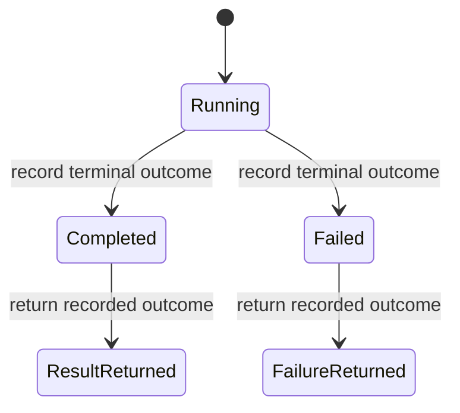

# @hobo/runtime

The **SDK runtime-primitives package**: app-facing authoring surfaces and the
deterministic-replay library that backs them.

- **Trainable methods (ADR-0025 / ADR-0125)** — `training(fn, opts)`,
  signature-only `training.define()` empty implementations served by a
  contract-derived stub (`defineGrounding()` is the same function under the
  name the registrations call that `hobo stub` generates for an ambient
  `@trainable declare class`, in `src/_generated/declared/<Class>.ts`;
  ADR-0128), the optional `@trainable` class decorator and `@intent` method
  decorator (including projects using `exactOptionalPropertyTypes`),
  the `"use training"` grounding lint, and `applyTrainingArtifact()` for
  apply-at-load promotion. See `src/training/`. The JSON types this surface
  is typed in (`JsonValue`, `JsonObject`, `JsonBag`) are exported from the
  root too, so a generated module whose exports infer `Trainable<JsonValue,
  JsonValue>` compiles with `declaration: true`.
- **Deterministic replay** (`./replay` export) — the replay, divergence,
  and equivalence engine (ADR-0086).

## Actors and workflows

`defineActor` and `activateActor` use an injected `ActorHost` for state,
leases, and fencing. A stale or contended lease cannot append actor state.
Actor commands invoke handlers that append events through the host; `state()`
reads the host's materialized view. On passivation, the SDK asks hosts that
support snapshots to save state and release the lease; other hosts release the
lease directly. If snapshotting fails, the SDK releases the lease, marks the
actor passivated, and reports the error. The host supplies the actor event store and
snapshot storage.

`createWorkflowEngine` journals completed steps and resumes a run with its
original seed and input. New journals also bind the definition name; older
journals did not record it. `start` generates a unique run ID; pass `{ runId }`
when the caller needs to retain the ID after an interruption. For compatibility,
`resume` also initializes an absent journal with the supplied ID. Only one worker
should resume a run at a time.

The default journal is in memory. Supply a durable `EventStoreWriter` to resume
after a process restart. A crash after an external effect and before its step is
recorded can cause that effect to run again, so external effects need their own
idempotency.

`agent` registers tool implementations as workflow steps. Actor, token, and
tool operations require their corresponding capabilities; unavailable or
undeclared capabilities raise `CapabilityDeniedError`.

A function with a `"use training"` directive can declare intent in a comment
immediately after the directive. `training.infer` accepts an explicit `intent`
override; otherwise it reads that comment, then the function's `trainingIntent`
property, and finally derives a default from the function name.
Applying a training artifact serves its exact matching examples for a function
with a body; other inputs still run that body. Removing the artifact restores
the body for every input.

`parseReplayReport` and `parseReplayDivergence` parse, don't validate: they
reject malformed input and return parsed domain types with validated sequence
vectors and digests.

## Naming: `runtime` vs `runtimes/`

These are different concerns that share a word:

- **`packages/runtime` (`@hobo/runtime`, this package)** — the *SDK
  primitives* layer app code imports (`import { training } from
  "@hobo/runtime"`); no I/O, no substrate.
- **`packages/runtimes/*` (e.g. `@hobo/runtime-local`)** — concrete *runtime
  backends* implementing the durable runtime ports (EventStore, Queue,
  Clock, component host) for a substrate. `runtime-local/src/replay.ts` is
  that backend's record/replay **link mode** (ADR-0076), not this package's
  replay engine.

The glossary's "Runtime" entry records the same disambiguation.

`WorkflowFailure` preserves an omitted step or cause as `undefined` rather than
manufacturing placeholder values.

## Durable workflows

Fresh workflows claim a new journal atomically before user steps execute. Generated IDs use random UUIDs; a host that needs the ID to recover after a crash can pass `{ runId }` to `start` and persist that ID first. A duplicate ID is rejected, assuming the event store enforces its expected-sequence compare-and-set.

An explicit run ID must be a nonempty primitive string for start, resume and
journal access. Omitting it on start generates an ID; passing null, a number,
an empty string or an object is rejected rather than coercing it into a stream
name. Rejection does not invoke conversion hooks on an object ID.

Workflow input must be an ordinary JSON tree. The engine captures it before
the first asynchronous operation, so later caller edits do not change the run.
Unsupported inputs, including `undefined`, non-finite numbers, dates, shared
references, proxies, accessors and frozen objects, are rejected before a new
journal is claimed. Convert them to explicit JSON before starting or resuming.
Older runs created from such inputs may need application-specific recovery.

Workflow and step results must be ordinary JSON trees or top-level `undefined`.
Dates, non-finite numbers, shared or circular references, accessors, proxies,
sparse arrays, frozen objects and other values that cannot be faithfully
replayed are refused. Results are captured before storage waits, so later edits
to the original do not change the first returned value. An unsupported result
raises a workflow failure; an unsupported step result also records a step
failure. A journaled `run.StepFailed` replays by rethrowing that failure without
re-running the step effect. Convert other values to explicit JSON. Values
already lost in older journals cannot be recovered.

The [workflow replay verification skill](../../.agents/skills/verify-workflow-replay/SKILL.md)
includes statecharts and bounded models for input and result capture. They
check 18 input states and 15 result states, including start and resume input
isolation (mutation checks on those capture sites), edits around journal
writes, and restarts. A 16-state model checks run-ID validation.

`resume` requires an existing `run.Started`, the original JSON-normalized input, and the recorded workflow name when available. Legacy journals without recorded input are interpreted as null input. It uses the recorded seed; old journals without a name cannot validate workflow identity, and those without a seed use the engine seed. Completed journaled steps are reused; a recorded `run.StepFailed` replays as failure without re-running the step. An external effect can still repeat if the host crashes after the effect and before recording its completion. Concurrent resumes require host-side fencing. See the [workflow replay verification skill](../../.agents/skills/verify-workflow-replay/SKILL.md).

A missing earlier step outcome is accepted only when that step was scheduled;
this permits recovery when parallel steps finish out of order. Replay validates
the recorded name before running the unfinished step and reuses later saved
outcomes. A workflow may catch a step failure, perform compensating steps, and
complete. Replay rethrows the saved failure into the workflow so it can take
the same path. The workflow cannot record either terminal state while a prior
outcome remains unconsumed. The bounded models check these paths and guards.

Resuming a completed or failed run returns its recorded terminal outcome without
calling the workflow or appending another event. Live `appendEvent` refuses
further `run.*` facts once a terminal is already in the in-memory journal, so
an unawaited step cannot corrupt a sealed run. A journal with multiple
terminal facts is rejected before returning an outcome. New failure records preserve
the failed step when present; older failure records without a step cannot
reconstruct that detail.

The terminal-outcome model explores 15 distinct states and 18 transitions.
The verification runner also checks that a resume which writes a second
terminal fact violates the model's invariant.
This projection hides ten transitions that do not change the displayed state;
it shows the modeled flow, rather than a trace of one execution.

