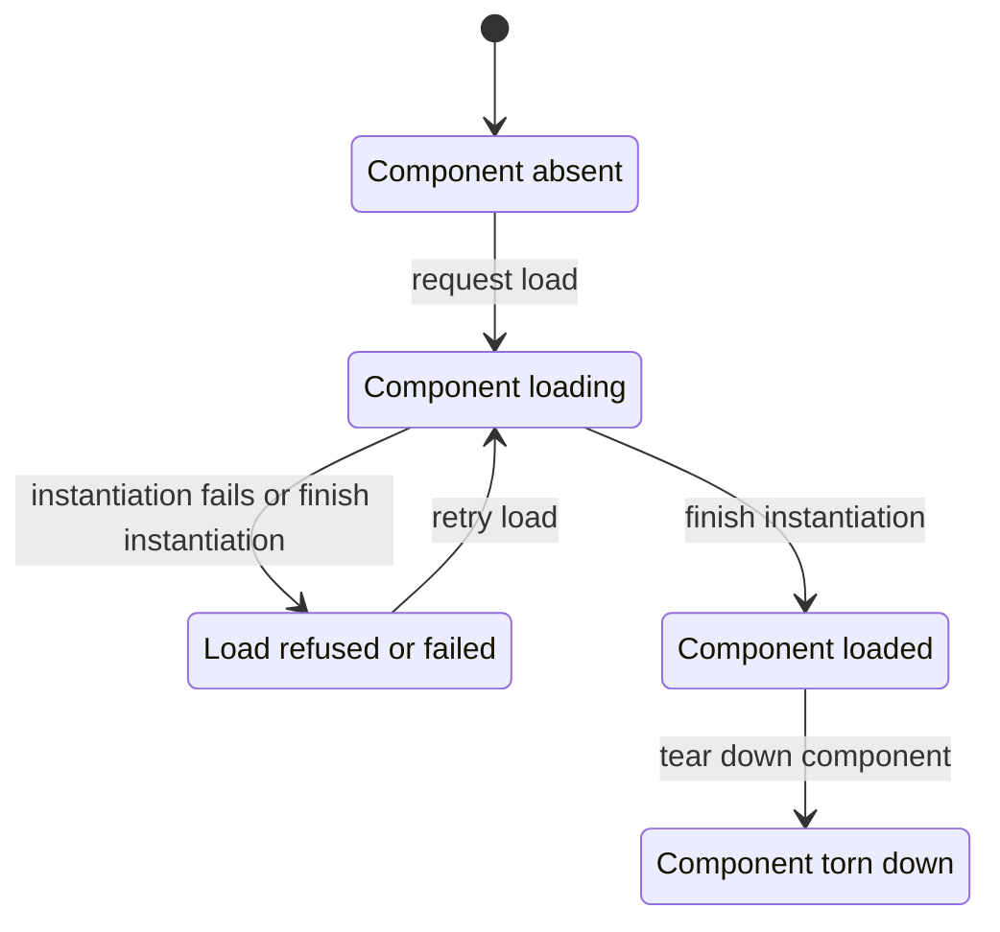

# @hobo/runtime-local

> **Naming:** `packages/runtimes/*` are concrete **runtime backends** (this
> package: the local/sqlite substrate). The singular `packages/runtime`
> (`@hobo/runtime`) is the app-facing **SDK primitives** package — a
> different concern; see its README for the full disambiguation.

Wasmtime-based runtime-local **component host** for HoBo S1. Loads descriptor-defined
guest components, routes WIT imports through a deny-by-default **link table**, and
appends `component.*` / `link.*` events to an injected event-log sink.

## Scope

**In:** component lifecycle, in-process link table, **wRPC in-process link layer**
(encode → route → decode, wire-version negotiation, membrane PACT), **capability
enforcement at the link table** (usage-inferred grants, deny-by-default routing,
`capability.GrantDenied` events), **local binding resolution** for offline dev
(`createLocalBindingResolver`), `wasi:http/incoming-handler@0.2.0`
dispatch, trap isolation, teardown cleanup, Wasmtime engine seam (in-process stub +
CLI version gate).

**Out:** wRPC cross-process transport, fuel/epoch limits, real `.wasm` byte execution,
OCI/wasmCloud adapters, conformance suite, grant inference from manifests.

## Usage

```ts
import { createRuntimeLocalComponentHost } from "@hobo/runtime-local";

const host = createRuntimeLocalComponentHost({
  appendEvent: (event) => eventLog.append(event),
});
```

Loading an already loaded or currently loading ID fails with
`component_already_loaded`; tear down the existing instance before replacing
it. The host captures requested leases before instantiation and rejects an
engine result whose ID differs from the requested ID. An instantiation error
releases the loading claim so the caller can retry.

The component-load model checks 78 bounded states. The projection hides 68
internal steps that do not change a displayed state.



The engine and event sink remain trusted. If the event sink throws after state
has changed, the host cannot determine whether the sink recorded the event;
the caller must reconcile that ambiguity. Teardown does not wait for in-flight
invocations.

## Tests

```bash
pnpm --filter @hobo/runtime-local test
```

## Architecture evidence

See [ARCHITECTURE.md](./ARCHITECTURE.md) for protobuf/CUE contracts, PACT boundary,
parse-don't-validate parsers, and event-sourced state naming.

Promoted from `src/draft/technical-proofs/runtime-local-component-host` in S1-02
(HOBO-591). wRPC link layer promoted in S1-03 (HOBO-592 / PR #784). Capability
enforcement promoted from `src/draft/technical-proofs/capability-enforcement-contract`
in S1-04 (HOBO-593). Binding resolver adapter added in S1-15 (HOBO-605).

## Durable EventStore reopen coverage

`createRuntimeLocalEventStore` delegates ID allocation to the shared
`@hobo/storage-sqlite` journal. Reopening with its default manual clock preserves
old IDs and permits new appends; IDs are never restarted from an empty-database
assumption. `test/eventstore-reopen-ids.test.ts` exercises this against real
SQLite. The generated API integration test also closes and reopens the default
store before resuming a journaled workflow without repeating completed effects.
