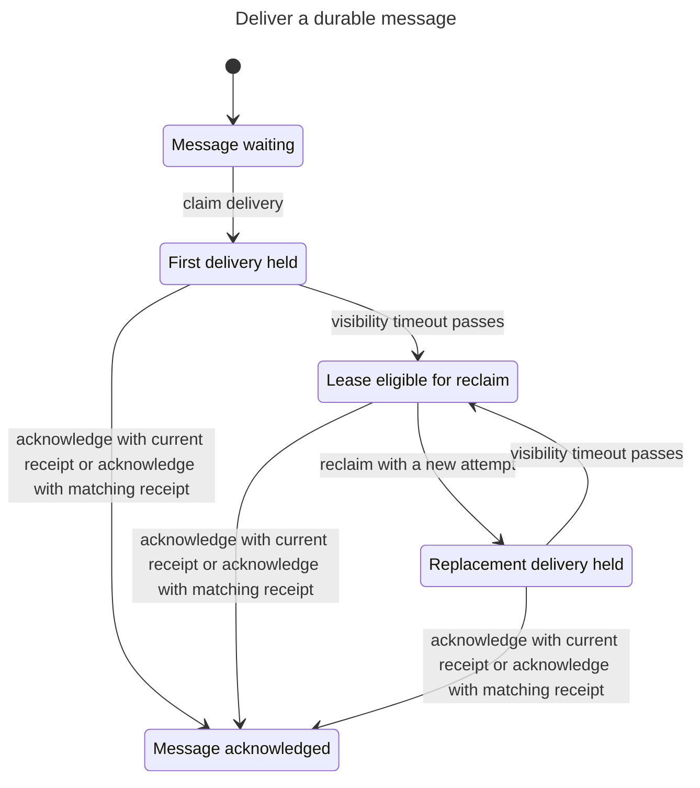

# `@hobo/storage-sqlite`

Driver-neutral SQLite schema, migrations, codecs, and commit semantics for HoBo’s
default durable EventStore / runtime journal.

SQLite is the **default engine**, not the public architecture boundary. Callers
depend on `@hobo/core` ports; native (`node:sqlite`) and browser (SQLite WASM +
OPFS) adapters implement a thin `SqliteDriver` and share this package’s SQL +
migration logic.

## Ownership model

One SQLite database file (partition) is owned by one active storage owner at a
time. Scale by partitions, not multi-writer WAL over shared network filesystems.
`createNodeSqliteDriver` requires an actual persistent SQLite file and rejects
memory databases and temporary paths, including SQLite memory URIs. Use
`createMemoryNodeSqliteDriver` explicitly for ephemeral tests and views.

## Schema version

`PRAGMA user_version` tracks schema revisions. Current: **2**.

## Engine profiles

| Profile | Driver | Journal | Notes |
|---|---|---|---|
| Native Node | `node:sqlite` | WAL + `synchronous=FULL` | Storage worker serializes access |
| Browser OPFS | `@sqlite.org/sqlite-wasm` | VFS-specific (not blind WAL) | Worker + `opfs-sahpool` default |
| Component host | WIT import | Host-supplied | No SQLite handles cross the membrane |

## Architecture rules

Parse, don't validate: journal inputs cross one parser boundary (stream ids,
expected revisions, fence tokens) and become derived types — branded positions
and fenced append requests — so `SqliteJournal` internals operate on parsed
values, not raw DTOs.

## Durable event IDs

Journal ULIDs are seeded from the durable event count on open. Allocation also
checks existing IDs inside the append transaction, so resetting a manual clock,
reopening a database, or interleaving independent local handles cannot reuse an
old event ID. The time/counter algorithm stays deterministic for fixture clocks;
this does not relax the single active storage-owner deployment model.
`packages/runtimes/runtime-local/test/eventstore-reopen-ids.test.ts` covers default
clock reopen and independent handles; the generated API execution test covers
workflow resume after reopen. EventEnvelope wire records and their Protobuf/CUE
constraints are unchanged; the storage journal tests exercise the append port.

## Queue and outbox delivery fencing

`leaseMessages` and `claimOutbox` return a persistent `deliveryAttempt` for
each receipt. Pass that value, together with the receipt's ID, lease ID, and
fence, to `completeMessage` or `ackOutbox`. The attempt increases on every
reclaim, even when a worker reuses the same lease ID and fence, so an earlier
receipt cannot complete a replacement lease. A visibility timeout permits
reclaim; the current receipt remains valid until another worker reclaims it.

The completion methods now require the attempt argument. Older callers that
omit it receive `false` and must be updated to use the returned receipt; this
can cause retries during a rolling upgrade. Existing databases already persist
the attempt counters, so no schema migration is required. Delivery remains
at-least-once and external side effects still need idempotency.

The `verify-outbox-lease` skill checks the same rule for queue and outbox
receipts using generated histories and a bounded TLA+ model, with reproducible scratch mutations of both receipt guards. This statechart
summarizes the checked model, not a live delivery trace:

The chart hides 264 steps whose visible label does not change. The model
explores three attempts for one message, including repeated lease IDs and fences;
it does not prove external delivery or exactly-once effects.

## Quorum-backed EventStore

`createQuorumEventStore` replays a majority-chosen immutable command journal into
a temporary SQLite view. It preserves event positions, transactional effects and
snapshots across a surviving provider majority. Optional non-expiring claims
protect configured stream prefixes and subscription checkpoints; transferring a
claim requires independently verified stop evidence.

A host must independently enroll the provider failure domains, fund and
authorize every voter and any recovery, and fence downstream effects. The adapter
does not itself establish those authorities or make external effects safe.
Replay is bounded by configured entry and byte limits. `assertQuorumEventStore`
recognizes an instance created by this module. `quorumEventStoreIdentity` reports
its immutable construction metadata, and `assertQuorumEventStoreJournal` checks
the attached journal by identity without exposing write authority. None of
these verify the fleet's provider enrollment, funding or health.

## Local-first `@alchemy.run/domain` host adapter

`@hobo/storage-sqlite/domain-platform` exposes `createSqliteDomainPlatform` and
`initSqliteDomainTables`, implementing `@alchemy.run/domain/Platform` on top of
any `SqliteDriver`. Aggregates, ordered event logs, idempotent command receipts,
materialized views, policy dedupe records, and projection checkpoints persist in
SQLite tables across full process restarts without requiring an external cloud
database.

